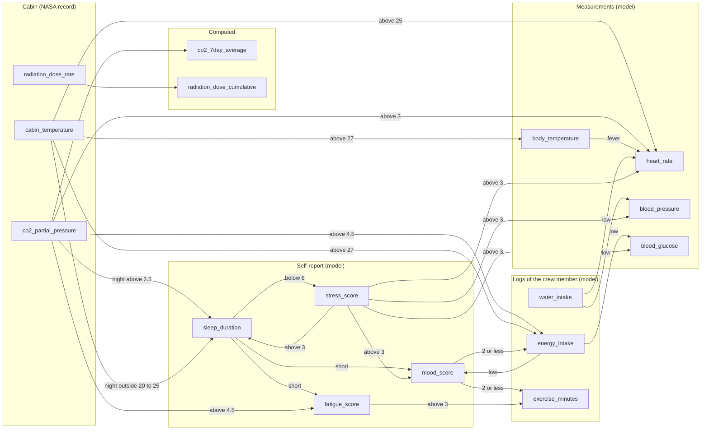

# Data correlations

What the monitoring in Nexxo can show and connect today, and how to validate it.

## 1. Purpose and how to read this document

This document describes what the server code does now.
It is different from [health-indicator-map.md](health-indicator-map.md):

| Document | Content |
|---|---|
| `health-indicator-map.md` | The research and the plan: 46 indicators, 62 relations, 20 rules. Most of it is not in the code. |
| This document | The part that the code has: 18 indicators, 29 relations, 23 cause checks, 19 rules, 5 crew patterns. |

Use this document for three things:

- To decide what the app shows. Section 9 lists the full chains from a cause to an action.
- To validate the app. Section 12 gives steps for each scenario.
- To find what to build next. Section 11 lists what the app cannot show.

Words that this document uses:

| Word | Meaning |
|---|---|
| Indicator | One value that the app stores over time, for example `heart_rate`. |
| Reading | One value of an indicator at one hour. |
| Relation | A known link from one indicator to another, for example "less sleep gives a lower mood". |
| Model | The code that creates the vitals of the crew. No space agency publishes real vitals. |
| Cause check | A test on the data that returns one sentence of evidence, or nothing. |
| Check-up | A question that the app asks a crew member when a rule finds a problem. |
| Personal baseline | The usual value of one indicator for one crew member. |
| Crew pattern | A result that needs the data of two or more crew members. |
| Team choice | A number that the team chose. No source gives it. |

Where the code is:

| File | Content |
|---|---|
| `server/src/indicators.ts` | The indicators and their limits. |
| `server/src/relations.ts` | The relations and the numbers of the model. |
| `server/src/dataset.ts` | The NASA record and the model of the vitals. |
| `server/src/causes.ts` | The cause checks, the causes of each symptom, the personal baseline. |
| `server/src/rules.ts` | The rules that start a check-up. |
| `server/src/crew.ts` | The crew patterns. |
| `server/src/monitor.ts` | The status of each indicator and the notifications. |
| `server/src/insights/` | The optional language model. |

If this document and the code do not agree, the code is right. Correct this document.

## 2. The five layers

The data passes through five layers. Each layer answers a different question.

| Layer | Question | Works on | Result |
|---|---|---|---|
| 1. Limits | Is this one value inside its range? | One reading | A status: normal, caution, or alert. A notification when the status gets worse. |
| 2. Rules | Does a value stay wrong, or do two values agree? | The last readings of one crew member, or of the cabin | A check-up: a question to the crew member. |
| 3. Cause checks | Which values in the data agree with a known cause of this symptom? | The cabin and one crew member | A list of possible causes with evidence. |
| 4. Crew patterns | Is this one person, or the whole crew? | All crew members together | A finding for the crew or for one person. |
| 5. Language model (optional) | What does all of this mean together? | All of the above for 7 days | A short text with findings and actions. |

Layers 1 to 4 are fixed code. They always run, and they give the same result for the same data.
Layer 5 is optional and can be off.

## 3. The indicators

The app has 18 indicators.
"Alert" is every value outside the caution range.

### 3.1 Cabin

All crew members share these values. The app has one cabin and no modules.

| id | Unit | Each | Source | Normal | Caution |
|---|---|---|---|---|---|
| `co2_partial_pressure` | mmHg | hour | NASA record | up to 2.8 | up to 3.0 |
| `co2_7day_average` | mmHg | day | Computed from the hourly CO2 | up to 2.5 | up to 3.0 |
| `cabin_temperature` | °C | hour | NASA record | 20 to 25 | 18 to 27 |
| `cabin_humidity` | % | hour | NASA record | 30 to 60 | 25 to 75 |
| `radiation_dose_rate` | mGy each day | day | NASA record | up to 0.5 | up to 1.0 |
| `radiation_dose_cumulative` | mGy | day | Computed: the sum of all daily doses | up to 300 | up to 600 |

Facts about the real NASA record (mission RR-6, 45 days on the station):

- CO2 has a median of 2.44 mmHg. It is 2.5 mmHg or more in 445 of 1047 hours, and above 3.0 mmHg in 6 hours.
- The 7-day average of CO2 is at 2.5 mmHg or more on about 1 day in 5. So the real station is near the NASA limit. This is a true result, not an error.
- Temperature stays between 22.0 and 24.2 °C. Humidity stays between 38 and 60%. These two never leave the normal range in the record.
- The radiation dose stays between 0.27 and 0.31 mGy each day. The total of the 45 days is 12.7 mGy.

### 3.2 Crew member

A model creates all of these values. See section 4.

| id | Unit | Each | Normal | Caution |
|---|---|---|---|---|
| `heart_rate` | bpm at rest | hour | 50 to 100 | 40 to 120 |
| `blood_pressure_systolic` | mmHg | day | 90 to 130 | 85 to 140 |
| `blood_pressure_diastolic` | mmHg | day | 60 to 85 | 55 to 90 |
| `body_temperature` | °C | day | 36.1 to 37.5 | 35.5 to 38.0 |
| `blood_glucose` | mg/dL before food | day | 70 to 100 | 60 to 125 |
| `sleep_duration` | hours | day | 6 to 9.5 | 5 to 10.5 |
| `mood_score` | 1 (very low) to 5 (very good) | day | 3 to 5 | 2 to 5 |
| `stress_score` | 1 (calm) to 5 (very stressed) | day | 1 to 3 | 1 to 4 |
| `fatigue_score` | 1 (fresh) to 5 (exhausted) | day | 1 to 3 | 1 to 4 |
| `water_intake` | litres in the last day | day | 2.5 or more | 2.0 or more |
| `energy_intake` | % of the food target in the last day | day | 90 or more | 70 or more |
| `exercise_minutes` | minutes in the last day | day | 108 or more | 60 or more |

The daily values arrive at 07:00. The computed cabin values and the radiation dose arrive at 12:00.

### 3.3 Values that the server computes and does not store

| Value | How | Used by |
|---|---|---|
| Mission day | Hours since the start of the mission, divided by 24, plus 1 | Cause checks `long_flight` and `first_days` |
| Personal baseline | The mean of the 14 days that end 3 days before now. It needs 5 readings or more. | The fever rule, the cause checks, the crew patterns, the language model |

The last 3 days stay out of the baseline. So a new problem does not change the baseline at once.
A problem that lasts longer than 3 days starts to move the baseline. After about 17 days the problem is the new baseline.

## 4. The model: what drives what

### 4.1 Read this first

The app has no real vitals. The model in `dataset.ts` creates them.
Each value has three parts:

1. A base value for the person, for example 5.9 to 6.3 hours of sleep.
2. A random part for the day, different for each crew member.
3. The effects in the table below.

So a correlation in a chart shows the model. It does not show a discovery.
The model is useful for a different reason: it lets us test if the app finds a cause that we put into the data.

A scenario of the simulator changes only the cause. The model then changes the effects along the chain.
A value that a crew member types in also moves along the chain. For example, a typed sleep of 3 hours lowers the mood of the same day.

### 4.2 The effects

All numbers are team choices. The relation ids come from `relations.ts`.

| Cause | Effect | Size | Delay | Relation | Evidence for the relation |
|---|---|---|---|---|---|
| Cabin CO2 in the night (mean of 8 hours) above 2.5 mmHg | Sleep falls | 0.9 h for each mmHg | Same night | R06 | Weak |
| Cabin temperature in the night outside 20 to 25 °C | Sleep falls | 0.25 h for each °C | Same night | R19 | Weak |
| Stress above 3 the day before | Sleep falls | 0.3 h for each point | Same night | Section 3.3 of the map | Weak |
| Sleep below 6 h | Stress rises | 0.6 points for each hour | Next day | T1 | Weak |
| Sleep below 6.1 h | Fatigue rises | 0.8 points for each hour | Next day | R11 | Medium |
| Sleep below 6.1 h | Mood falls | 0.6 points for each hour | Next day | R10 | Medium |
| Stress above 3 | Mood falls | 0.4 points for each point | Same day | T6 | Weak |
| Food intake below 80% | Mood falls | 0.02 points for each % | Same day | R53 | Weak |
| Cabin CO2 (mean of 24 hours) above 4.5 mmHg | Fatigue rises | 1.5 points | Same day | R02 | Strong |
| Cabin CO2 (mean of 24 hours) above 4.5 mmHg | Food intake falls | 15% | Same day | R03 | Strong |
| Cabin temperature (mean of 24 hours) above 27 °C | Food intake falls | 3% for each °C | Same day | Team choice | None |
| Mood of 2 or less the day before | Food intake falls | 8% | Next day | Team choice | None |
| Food intake below 90% | Fatigue rises | 0.03 points for each % | Same day | Team choice | None |
| Mood of 2 or less the day before | Exercise falls | 30 minutes | Next day | R62 | Weak |
| Fatigue above 3 the day before | Exercise falls | 20 minutes for each point | Next day | T7 | Weak |
| Food intake below 85% | Blood sugar falls | 0.3 mg/dL for each % | Same day | R52 | Strong |
| Stress above 3 | Blood sugar rises | 3 mg/dL for each point | Same day | T5 | Weak |
| Water below 2.2 litres | Upper blood pressure falls | 8 mmHg for each litre | Same day | T4 | Weak |
| Water below 2.2 litres | Lower blood pressure falls | 4 mmHg for each litre | Same day | T4 | Weak |
| Stress above 3 | Upper blood pressure rises | 4 mmHg for each point | Same day | T2 | Weak |
| Cabin temperature (mean of 24 hours) above 27 °C | Body temperature rises | 0.1 °C for each °C | Same day | R20 | Medium |
| Cabin temperature above 25 °C | Heart rate rises | 2 bpm for each °C | Same hour | R21 | Weak |
| Cabin CO2 above 3 mmHg | Heart rate rises | 3 bpm for each mmHg | Same hour | R04 | Weak |
| Body temperature more than 0.4 °C above the usual value of the person | Heart rate rises | 10 bpm for each °C | Hours | T3 | Weak |
| Water below 2.2 litres | Heart rate rises | 6 bpm for each litre | Hours | R50 | Weak |
| Stress above 3 | Heart rate rises | 2 bpm for each point | Hours | Team choice | None |
| Daily radiation dose | Mission total of the dose rises | The sum | At once | R29 | Strong |

### 4.3 Chart of the model

### 4.4 Loops in the model

Two loops make a problem stronger over days. Know them before you read a chart.

- Short sleep raises stress. High stress shortens the next sleep.
- Low mood lowers food intake. Low food intake lowers mood.

### 4.5 What has no effect in the model

These indicators are in the app, but nothing in the model reacts to them:

- `cabin_humidity` changes no vital.
- `radiation_dose_rate` changes no vital. Only the cause checks use it.
- `exercise_minutes` changes no other value. It is an end of a chain.
- `blood_glucose`, `blood_pressure`, `body_temperature` and `heart_rate` change no self-report value.

## 5. Layer 1: limits and status

Each new reading gets a status from the fixed ranges in section 3.
When the status gets worse, the app sends one notification.

| Subject | Who gets the notification |
|---|---|
| A cabin indicator | The engineers. For an alert, also the commander. |
| A crew indicator | That crew member, and the medical officers. |

The app sends a notification about the same topic one time in 48 hours, unless the status gets worse.

Limits of this layer:

- It compares with fixed ranges only. It does not use the personal baseline.
- It looks at one reading. It does not see a trend.
- It knows no cause. The other layers add that.

## 6. Layer 2: the rules that start a check-up

A rule tests the newest readings. If the test is true, the app asks the crew member a question.
If the crew member answers "yes", the app records a symptom and tells the person in the last column.

"Context" is the list of cause checks (section 7) that the app runs when the rule starts a check-up.
The app adds what they find to the reason. So the crew member sees the trigger and the other values that agree with a known cause.

The app asks the same question to the same crew member one time in 24 hours at most.
It does not ask while an older question has no answer, or while the crew member has the same symptom open.

### 6.1 Rules with a cabin trigger

All crew members get the question, because they share the cabin.

| Rule id | Trigger | Question | Context | On "yes", tell |
|---|---|---|---|---|
| `co2_headache` | Mean CO2 of the last 3 hours is 2.8 to 4.5 mmHg | Do you have a headache? | `co2_week`, `sleep_short`, `water_low` | Crew medical officer |
| `co2_severe` | Mean CO2 of the last 3 hours is 4.5 mmHg or more | Do you feel very tired or sick in the stomach? | `energy_low`, `sleep_short` | Flight surgeon |
| `co2_week` | 7-day average of CO2 is 2.5 mmHg or more, and the crew member slept less than 6 hours for 2 nights | Did you wake with a headache in the last days? | `co2_high`, `cabin_uncomfortable`, `stress_high` | Crew medical officer |
| `radiation_high` | The newest daily dose is above 0.5 mGy | Do you feel nausea or unusual tiredness? | None | Flight surgeon |
| `cabin_hot` | Cabin above 27 °C for 3 hours | Do you feel hot, thirsty or dizzy? | `water_low`, `fever`, `heart_fast` | Nobody |

`co2_week` is the only rule whose trigger joins a cabin value with a value of the crew member.

### 6.2 Rules with a trigger from one crew member

| Rule id | Trigger | Question | Context | On "yes", tell |
|---|---|---|---|---|
| `heart_rate_high` | Heart rate above 100 bpm for 3 hours | Do you feel chest pain or a pounding heart? | `cabin_hot`, `co2_very_high`, `co2_high`, `fever`, `water_low`, `stress_high`, `sleep_short` | Flight surgeon |
| `heart_rate_low` | Heart rate below 50 bpm for 3 hours | Do you feel dizzy or faint? | `pressure_low`, `energy_low` | Crew medical officer |
| `fever` | Body temperature 1.0 °C or more above the personal baseline. Without a baseline: above 38 °C. | Do you have chills, a sore throat or a cough? | `cabin_hot`, `heart_fast`, `stress_high`, `sleep_short` | Crew medical officer |
| `pressure_high` | Upper blood pressure above 140 mmHg | Do you have a headache or blurred vision? | `stress_high`, `co2_high`, `sleep_short` | Flight surgeon |
| `pressure_low` | Upper blood pressure below 85 mmHg | Do you feel dizzy or weak? | `water_low`, `energy_low`, `cabin_hot` | Crew medical officer |
| `glucose_low` | Blood sugar below 60 mg/dL | Do you feel shaky, sweaty or confused? | `energy_low`, `mood_low` | Crew medical officer |
| `glucose_high` | Blood sugar above 125 mg/dL | Are you very thirsty, or do you urinate more than usual? | `stress_high`, `fever`, `exercise_low` | Flight surgeon |
| `sleep_debt` | Sleep below 5.5 hours for 3 nights | Do you feel too tired to work safely? | `co2_very_high`, `co2_high`, `co2_week`, `cabin_uncomfortable`, `stress_high` | Crew medical officer |
| `mood_low` | Mood of 2 or less for 2 days | Do you want to talk with the crew medical officer or the ground team? | `sleep_short`, `stress_high`, `energy_low`, `exercise_low` | Flight surgeon |
| `nutrition_low` | Food intake below 70% for 3 days | Is your appetite low, or does food taste different? | `glucose_low`, `mood_low`, `co2_very_high`, `cabin_hot`, `stress_high` | Crew medical officer |
| `water_low` | Water below 2 litres for 2 days | Is your urine dark, or do you have pain in the side of your lower back? | `cabin_hot`, `air_dry`, `pressure_low`, `heart_fast` | Crew medical officer |
| `exercise_missed` | Exercise below 60 minutes for 3 days | Did pain or weakness stop your exercise? | `mood_low`, `sleep_short`, `energy_low`, `fever` | Crew medical officer |
| `stress_long` | Stress of 4 or more for 3 days | Do you want to talk with the crew medical officer or the ground team? | `sleep_short`, `mood_low`, `co2_week` | Crew medical officer |
| `fatigue_high` | Fatigue of 4 or more for 2 days | Do you feel too tired to work safely? | `sleep_short`, `co2_very_high`, `co2_high`, `co2_week`, `energy_low`, `fever`, `radiation_high` | Crew medical officer |

Example of a reason with context, from a test of the scenario "CO2 builds up":

> You slept less than 5.5 hours for 3 nights (4.6 hours on average). Other values that can be part of the cause: (1) Cabin CO2 was 3.59 mmHg on average in the last 3 hours, and 3.60 mmHg at the highest in the last 24 hours. Crews report headaches from 2.8 mmHg. (2) The 7-day average of cabin CO2 is 2.63 mmHg. NASA keeps it below 2.5 mmHg, because then the headache risk is under 1%.

## 7. Layer 3: the cause checks

A cause check reads the data and returns one sentence of evidence, or nothing.
It never makes a diagnosis. It shows where to look first.

The column "Scope" tells whose data the check reads:

- `cabin`: the same for all crew members.
- `person`: the data of one crew member.
- `flight`: true for every crew member on a long flight. It explains a symptom in general, but not why it occurs today.

### 7.1 The 23 checks

| Check id | Scope | True when | Relation | Evidence |
|---|---|---|---|---|
| `co2_very_high` | cabin | Mean CO2 of the last 3 hours is 4.5 mmHg or more | R02, R03 | Strong |
| `co2_high` | cabin | Mean CO2 of the last 3 hours is 2.8 to 4.5 mmHg, or the highest value of the last 24 hours is above 3.0 mmHg | R01 | Strong |
| `co2_week` | cabin | Mean CO2 of the last 7 days is 2.5 mmHg or more | R01, R06 | Strong |
| `cabin_hot` | cabin | Mean cabin temperature of the last 3 hours is above 27 °C | R20, R21 | Medium |
| `cabin_uncomfortable` | cabin | Mean cabin temperature of the last 24 hours is outside 20 to 25 °C | R19 | Weak |
| `air_dry` | cabin | Mean humidity of the last 24 hours is below 30% | R22 | Medium |
| `radiation_high` | cabin | A daily dose of the last 2 days is above 0.5 mGy | R30 | Medium |
| `sleep_short` | person | Sleep last night below 5.5 hours, or the mean of 3 nights below 5.5 hours | R10, R11 | Medium |
| `water_low` | person | Water in the last day below 2.5 litres | R50, T4 | Weak |
| `energy_low` | person | Food in the last day below 80%, or the mean of 3 days below 85% | R52, R53 | Medium |
| `glucose_low` | person | Last blood sugar below 70 mg/dL | R52 | Strong |
| `glucose_high` | person | Last blood sugar above 125 mg/dL | Section 3.3 of the map | Weak |
| `fever` | person | Body temperature above 38 °C, or 1.0 °C or more above the personal baseline | T3 | Medium |
| `pressure_low` | person | Last upper blood pressure below 90 mmHg | T4 | Weak |
| `pressure_high` | person | Last upper blood pressure above 140 mmHg | Section 3.3 of the map | Weak |
| `heart_fast` | person | Mean heart rate of the last 3 hours above 100 bpm, or 15 bpm or more above the personal baseline | Section 3.3 of the map | Weak |
| `stress_high` | person | Last stress of 4 or more, or the mean of 3 days at 3.5 or more | R56, T2, T6 | Weak |
| `mood_low` | person | Last mood of 2 or less | R62 | Weak |
| `exercise_low` | person | Mean exercise of the last 7 days below 90 minutes | R40 | Strong |
| `long_flight` | flight | Mission day above 30 | R34 | Strong |
| `first_days` | flight | Mission day 4 or less | R32 | Strong |
| `fluid_shift` | flight | Always | R35 | Medium |
| `spine_unloaded` | flight | Always | Section 4.4 of the map | Weak |

Notes:

- Some checks use a softer limit than the status of the indicator. For example, `glucose_low` is true below 70 mg/dL, but the rule `glucose_low` starts below 60 mg/dL. A cause check only supports a symptom that exists, so it can be more sensitive.
- `sleep_short` uses 5.5 hours and not 6 hours. Crews sleep about 6 hours on the station, so 6 hours is usual.
- A new mission starts on day 45, because it loads the 45 days of the NASA record. So `first_days` is never true in the app today.

### 7.2 From a symptom to its causes

When a crew member reports a symptom, the app runs the checks of that symptom in this order.
The first true check gives the "first step" in the notification.
The app also looks for other crew members with the same open symptom in the last 48 hours.

| Symptom | Checks, most important first |
|---|---|
| Headache | `co2_very_high`, `co2_high`, `co2_week`, `sleep_short`, `water_low`, `pressure_high`, `fever`, `glucose_low`, `stress_high`, `fluid_shift` |
| Dizziness | `pressure_low`, `water_low`, `glucose_low`, `cabin_hot`, `co2_very_high`, `energy_low`, `first_days` |
| Blurred vision | `long_flight`, `glucose_high`, `pressure_high`, `air_dry` |
| Fatigue | `sleep_short`, `co2_very_high`, `co2_high`, `energy_low`, `fever`, `radiation_high`, `water_low`, `mood_low` |
| Stuffy nose | `fluid_shift`, `air_dry`, `fever` |
| Low mood | `sleep_short`, `stress_high`, `energy_low`, `co2_high`, `exercise_low` |
| Chest pain (emergency) | `heart_fast`, `pressure_high`, `fever`, `stress_high`, `co2_very_high`, `co2_high` |
| Palpitations | `heart_fast`, `cabin_hot`, `water_low`, `fever`, `stress_high`, `co2_very_high`, `co2_high`, `glucose_low`, `sleep_short` |
| Cough | `fever`, `air_dry` |
| Short of breath (emergency) | `co2_very_high`, `co2_high`, `heart_fast`, `fever` |
| Nausea | `co2_very_high`, `radiation_high`, `first_days`, `cabin_hot`, `glucose_low` |
| Stomach pain | `energy_low`, `water_low`, `stress_high` |
| No appetite | `co2_very_high`, `mood_low`, `stress_high`, `cabin_hot`, `fever` |
| Back pain | `spine_unloaded`, `exercise_low` |
| Muscle pain | `exercise_low`, `water_low` |
| Weakness | `exercise_low`, `energy_low`, `glucose_low`, `sleep_short`, `fever` |
| Skin rash | `air_dry`, `stress_high`, `radiation_high`, `fever` |
| Heat stress | `cabin_hot`, `water_low`, `fever` |
| Fever | `fever`, `cabin_hot`, `sleep_short`, `stress_high` |
| Low blood sugar signs | `glucose_low`, `energy_low` |
| High blood sugar signs | `glucose_high`, `stress_high`, `fever` |
| Dehydration signs | `water_low`, `cabin_hot`, `air_dry`, `pressure_low`, `heart_fast` |
| Stress | `stress_high`, `sleep_short`, `co2_week` |
| Numbness | No checks |
| Joint pain | No checks |

Who gets the notification:

- A usual symptom goes to the medical officers.
- "Chest pain" and "Short of breath" also go to the flight surgeons on the ground, with the highest severity.

The app stores the result with the symptom, in the field `explanation`. The result shows the data at the time of the report.

Example, from a test of the scenario "CO2 builds up":

> Possible causes in the data: (1) Cabin CO2 was 3.11 mmHg on average in the last 3 hours, and 3.21 mmHg at the highest in the last 24 hours. Crews report headaches from 2.8 mmHg. (2) The 7-day average of cabin CO2 is 2.51 mmHg. NASA keeps it below 2.5 mmHg, because then the headache risk is under 1%. First step: Move to a module with better air flow. Ask the engineer to check the CO2 removal system. Alex Reyes also reports this symptom. Look for a cause that they share.

## 8. Layer 4: crew and crew member

The rules look at one crew member at a time. This layer compares the crew members with each other and with the cabin.
It answers the question "is this one person, or the whole crew?".

### 8.1 The five patterns

| Pattern | True when | Scope | Severity | Who gets it |
|---|---|---|---|---|
| Shared symptom | 2 or more crew members have the same open symptom from the last 48 hours | Crew | Caution. Alert for 3 or more people, for "Fever" and "Cough", and for an emergency symptom. | Medical officer and commander. Also the engineer if a shared cause is in the cabin. Also the ground for an alert. |
| Fever in the crew | 2 or more crew members pass the check `fever` | Crew | Alert | Medical officer, commander, ground |
| Crew trend | The whole crew moved away from its baselines (see 8.2) | Crew | Caution | Commander and medical officer. Also the engineer if the cabin shows a cause. |
| One crew member against the rest | One crew member moved away from the personal baseline, and the rest did not (see 8.2) | Individual | Caution | That crew member and the medical officer |
| One "yes" among "no" | In the last 48 hours, exactly one crew member answered "yes" to a check-up with a cabin trigger, and one or more answered "no" | Individual | Caution | That crew member, the medical officer, the engineer |

What each pattern tells the crew:

- **Shared symptom.** The app runs the checks of the symptom for each person. A cause counts as shared when it is true for all of them. If no cause is shared, the app says to ask what they had in common: food, water, work place, sleep place.
- **Fever in the crew.** An infection can spread in a closed cabin. If the cabin is also hot, the app says that heat alone can raise body temperature.
- **Crew trend.** The app runs all cabin checks. If one is true, the finding names it as the possible cause. If none is true, the finding says to check the work schedule, the sleep schedule, and the team.
- **One crew member against the rest.** The cabin is the same for all, so the cause is probably personal. But if the whole crew changed in another indicator in the same days, the finding says that the cause is probably the same for all and this person reacts more.
- **One "yes" among "no".** This person reacts more to the cabin value, or works or sleeps in a place where the value is worse than at the sensor.

### 8.2 How the app compares the crew

The app compares 7 daily indicators.
For each crew member it computes the "move": the mean of the last 3 days minus the personal baseline, in the bad direction.
A comparison of moves is fair to a person who always sleeps less than the others.

| Indicator | Bad direction | Crew trend from a mean move of | One crew member from a gap of |
|---|---|---|---|
| `sleep_duration` | Lower | 0.8 h | 1.2 h |
| `mood_score` | Lower | 0.8 points | 1.5 points |
| `stress_score` | Higher | 0.8 points | 1.3 points |
| `fatigue_score` | Higher | 0.8 points | 1.5 points |
| `energy_intake` | Lower | 12% | 15% |
| `water_intake` | Lower | 0.5 litres | 0.6 litres |
| `exercise_minutes` | Lower | 25 minutes | 30 minutes |

- **Crew trend:** the mean move of the crew passes the limit, and three quarters of the crew or more moved half of the limit or more.
- **One crew member:** the move of this person is larger than the mean move of the rest by the gap or more, and the move alone is 75% of the gap or more. This needs 3 crew members or more.

All numbers in this table are team choices. The gaps are about 2.5 times the usual spread of a 3-day mean in the model.

### 8.3 What each view can show

| Question | For one crew member | For the crew |
|---|---|---|
| Is a value outside its range? | Status of each indicator | Count of crew members with a caution or an alert for each indicator |
| Is a value unusual for this person? | Value against the personal baseline | Mean move of the crew against its baselines |
| Why do I have this symptom? | The `explanation` of the symptom | The shared causes in a "shared symptom" finding |
| Is it only me? | "No other crew member reports this symptom", or the names | The count in the title: "2 of 4 crew members report: Headache" |
| Is the cause the cabin or personal? | Scope of each cause: cabin, person, or flight | Crew trend with or without a cabin cause |
| Who must act? | The role in the check-up and in the notification | The roles of the finding |

## 9. Chains that the app can show from start to end

Each chain names a cause, what the model changes, and what each layer does with it.
These are the stories that the app can tell today.

### 9.1 CO2 in the cabin

1. Cause: `co2_partial_pressure` rises.
2. Model: sleep falls the same night. Stress and fatigue rise and mood falls the next day. Heart rate rises a little above 3 mmHg. Above 4.5 mmHg, food intake falls and fatigue rises more.
3. Limits: "Cabin CO2" goes to caution above 2.8 mmHg and to alert above 3.0 mmHg. Some days later "Cabin CO2, 7-day average" goes to caution.
4. Rules: `co2_headache` asks all crew members about a headache. Later `co2_week` and `sleep_debt` start, and their reasons name CO2.
5. Cause checks: a report of headache, fatigue, low mood, palpitations, chest pain, or short of breath names the CO2 values.
6. Crew patterns: "The whole crew sleeps less than usual", with CO2 as the cabin cause. If 2 crew members confirm the headache, a shared-symptom finding names CO2. If only one confirms, the "one yes among no" finding starts.

### 9.2 Heat in the cabin

1. Cause: `cabin_temperature` rises.
2. Model: heart rate rises above 25 °C. Above 27 °C, body temperature rises and food intake falls. Sleep falls when the night is above 25 °C.
3. Rules: `cabin_hot` asks all crew members after 3 hours above 27 °C.
4. Cause checks: a report of dizziness, palpitations, nausea, no appetite, or heat stress names the cabin temperature.
5. Crew patterns: "The whole crew sleeps less than usual", with the cabin temperature as the cause.

### 9.3 Infection in one crew member

1. Cause: `body_temperature` of one crew member rises.
2. Model: the heart rate of this crew member rises about 10 bpm for each °C of fever.
3. Rules: `fever` starts at 1.0 °C above the personal baseline.
4. Cause checks: a report of fatigue, weakness, palpitations, cough, or headache names the body temperature.
5. Crew patterns: nothing for one person. If a second crew member gets a fever, "2 crew members have a raised body temperature" goes to the ground as an alert.

### 9.4 Low food intake

1. Cause: `energy_intake` of one crew member falls.
2. Model: blood sugar falls, fatigue rises, and mood falls below 80%.
3. Rules: `nutrition_low` after 3 days below 70%. `glucose_low` if blood sugar falls below 60 mg/dL.
4. Cause checks: a report of weakness, dizziness, fatigue, low mood, or stomach pain names the food intake. Below 70 mg/dL it also names the blood sugar.
5. Crew patterns: "this crew member eats less than usual, and the rest of the crew does not".

This is the chain for the example "blood values can show that a person eats too little". The app shows it from the food log, and blood sugar supports it.

### 9.5 Low water intake

1. Cause: `water_intake` of one crew member falls.
2. Model: blood pressure falls and heart rate rises, below 2.2 litres.
3. Rules: `water_low` after 2 days below 2 litres.
4. Cause checks: a report of headache, dizziness, fatigue, palpitations, muscle pain, or stomach pain names the water intake.
5. Crew patterns: "this crew member drinks less than usual, and the rest of the crew does not".

### 9.6 Short sleep without a cabin cause

1. Cause: `sleep_duration` falls for all crew members, for example from a shifted schedule.
2. Model: stress and fatigue rise, mood falls, and then exercise falls.
3. Rules: `sleep_debt`, `fatigue_high`, `stress_long`, and `mood_low`. Each reason names the short sleep.
4. Crew patterns: "The whole crew sleeps less than usual. The cabin data shows no cause. Check the work schedule, the sleep schedule, and how the team works together."

The difference between this chain and chain 9.1 is the main proof that the crew layer works: the same symptoms, but one has a cabin cause and one does not.

### 9.7 Radiation

1. Cause: `radiation_dose_rate` rises.
2. Model: no vital changes. The mission total rises.
3. Limits: "Radiation dose" goes to caution above 0.5 mGy and to alert above 1.0 mGy.
4. Rules: `radiation_high` asks all crew members about nausea and tiredness.
5. Cause checks: a report of nausea, fatigue, or skin rash names the dose of the last 2 days.

### 9.8 Long time in flight

1. Cause: the mission day passes 30.
2. Cause checks: a report of blurred vision names the eye syndrome SANS and the mission day.

This chain has no measurement behind it. The app has no vision test and no eye scan.

## 10. Layer 5: what the language model gets

The language model is optional. The fixed layers never depend on it.
The server sends this data as JSON:

| Field | Content |
|---|---|
| `mission` | Name, mission day, time |
| `limits` | The normal and caution range of each indicator, and why the crew measures it |
| `relations` | The 29 relations: cause, effect, direction, delay, strength of the evidence |
| `cabin` | For each cabin indicator: the newest value, its status, its source, and the mean, lowest and highest value of 24 hours, and the mean of 7 days |
| `cabin_last_7_days` | One value for each of the last 7 days, oldest first. For an hourly indicator it is the mean of the day. |
| `crew[].readings` | The same numbers as `cabin`, for each crew member |
| `crew[].personal_baseline` | The baseline of each indicator |
| `crew[].last_7_days` | One value for each of the last 7 days, for each indicator |
| `crew[].symptoms` | The symptoms of the last 7 days |
| `crew_patterns` | The findings of layer 4 |
| `check_ups_last_3_days` | The questions, the answers, and the reasons |
| `status_changes_last_3_days` | The status changes |

The instructions tell the model to do these things:

- Compare each crew member with the personal baseline first, and with the fixed limits second.
- Compare the crew members with each other, to separate a personal cause from a shared cause.
- Check the order in time. A cause must come before its effect.
- Use a relation only when the data shows both changes, and say when the evidence is weak.
- Not diagnose a disease, and not name a medicine or a dose.

The model does not get the settings of the simulator. It must find the cause from the readings.

What the model can add to the fixed layers: it can connect more than two values in one text, and it can explain a case that no rule covers.
We did not test the new context with a real model yet.

## 11. What the app cannot show today

### 11.1 Missing data

| Missing | What we cannot show because of it |
|---|---|
| Modules, and the place of each crew member | "CO2 is high in the sleep area of this person". The "one yes among no" finding can only guess a local cause. |
| Oxygen, cabin pressure, blood oxygen (`spo2`) | Hypoxia and a cabin leak (chain CH2 in the map) |
| Noise and light | The other common causes of bad sleep in flight |
| Workload, sleep schedule, spacewalks | The cause of "short sleep without a cabin cause". Today the app can only say "check the schedule". |
| Medicines | A medicine as the cause of a changed reading. The map says to check this first. |
| Meals and exercise time of today | "The heart rate is high because you exercised 20 minutes ago" |
| Body mass | Malnutrition over weeks, and muscle loss |
| Urine values and kidney pain | The kidney stone chain (CH5 in the map) |
| Vision test, eye scan | A measurement for SANS |
| Bone density estimate | The long-term effect of missed exercise |
| Cognition test | The effect of sleep, CO2 and stress on attention |
| Severity of a symptom (0 to 10) | "The headache gets worse", and rules that depend on severity |
| Proton flux and space weather | A warning before the radiation dose rises |
| Communication delay | Who leads when the ground cannot answer |

### 11.2 Limits of the method

- The cause checks use limits, not statistics. The app never computes a correlation number from the data.
- The app does not check the order in time. A cause check can name a CO2 peak that came after the headache started.
- A check looks at one value at a time. It does not weigh two weak causes against one strong cause. The order in section 7.2 is fixed.
- A symptom is free text. Only the names in section 7.2 have checks. A typed name such as "head pain" gets no causes.
- "Numbness" and "Joint pain" have no checks. The map marks joint pain after a pressure fall as an emergency.
- The baseline moves when a problem lasts longer than 3 days.
- The crew patterns need a baseline, so they need about 8 days of readings. A new crew member gets none before that.
- The random part of the model can start a pattern on a quiet day. In our tests, one crew member got "more stress than usual" without a scenario.
- A limit of one night of sleep at 6 hours gives a caution on about 1 night in 3, because the model follows the real mean of 6.1 hours on the station.

### 11.3 What is real and what is not

| Part | Status |
|---|---|
| Cabin values | Real NASA record of one past mission |
| Limits for the cabin | From NASA standards and technical briefs |
| Limits for the vitals | Usual clinical ranges for adults on Earth, and team choices |
| Vitals of the crew | A model |
| Sizes of the effects in the model (section 4.2) | Team choices |
| Direction of the relations | From the sources in the map, with the evidence in the tables |
| Limits of the cause checks and of the crew patterns | Team choices |

No doctor reviewed any of these numbers. The app is a prototype and does not give medical advice.

## 12. How to validate

### 12.1 Validate the mechanics with the scenarios

For each scenario:

1. Create a new mission. An old mission has no history for the new indicators.
2. Move the clock 2 days with no scenario, and note the open check-ups and notifications. This is the noise level.
3. Start the scenario in the simulator.
4. Move the clock by the time in the table.
5. Compare with the column "Expect". The times and values come from one test run, so small differences are normal.

| Scenario | Change | Expect |
|---|---|---|
| CO2 builds up | CO2 plus 1.2 mmHg | After some hours: check-up `co2_headache` for all. After about 1.5 days: `co2_week`. After about 2.5 days: crew sleep near 5.1 h against the usual 6.2 h, and the finding "The whole crew sleeps less than usual" with CO2 as the cause. |
| Bad sleep for all | Sleep minus 1.8 h for all | After about 1.5 days: the same crew finding, but with "The cabin data shows no cause". Then `fatigue_high`, `sleep_debt`, and for some crew members `mood_low` and `stress_long`. |
| Cooling fails | Cabin plus 6 °C, humidity plus 15% | After 3 hours: check-up `cabin_hot` for all. Heart rates about 8 bpm higher. After about 1.5 days: the crew sleep finding with the cabin temperature as the cause. |
| One crew member gets sick | Body temperature plus 1.8 °C for the first crew member | At the next 07:00: check-up `fever` with "above your usual value". Heart rate of this person about 12 bpm higher. No crew finding. |
| One crew member eats too little | Food minus 40% for the second crew member | After about 1.5 days: "eats less than usual, and the rest of the crew does not". After 3 days: check-up `nutrition_low`. Blood sugar about 8 mg/dL lower. |
| One crew member drinks too little | Water minus 1.2 litres for the third crew member | After 1 to 2 days: "drinks less than usual, and the rest of the crew does not". After 2 to 3 days: check-up `water_low`. Upper blood pressure about 3 mmHg lower. |
| Solar particle event | Daily dose plus 1.5 mGy | At the next 12:00: "Radiation dose" is alert, and check-up `radiation_high` for all. A report of nausea names the dose. |

Tests for the crew layer that need actions of a person:

1. **Shared symptom with a cabin cause.** Start "CO2 builds up", move the clock 6 hours, and report "Headache" for 2 crew members. Expect "2 of 4 crew members report: Headache", with CO2 as the shared cause, for the medical officer, the commander and the engineer.
2. **Shared symptom with no cause.** With no scenario, report "Stomach pain" for 2 crew members. Expect the same kind of finding with "The data shows no cause that they share".
3. **One "yes" among "no".** Start "CO2 builds up" and wait for the check-up `co2_headache`. Answer "yes" for one crew member and "no" for two. Expect "Only ... has symptoms from: high co2 in the cabin".
4. **Fever in the crew.** Add 1.8 °C to the body temperature of 2 crew members and move the clock 1 day. Expect "2 crew members have a raised body temperature" as an alert for the ground.
5. **Emergency symptom.** Report "Chest pain". Expect a notification with the highest severity for the medical officer and for the ground.

### 12.2 Validate the medical content

The mechanics can be right while the content is wrong. A person with medical knowledge must review these parts:

| Part | Where | What to check |
|---|---|---|
| The order of the causes for each symptom | Section 7.2 | Is the first cause the right one to check first? Is a common cause missing? |
| The limits of the cause checks | Section 7.1 | For example: is 5.5 hours the right limit for "short sleep"? Is 15 bpm above the baseline the right limit for a fast heart rate? |
| The questions and the advice of the rules | Section 6 and `rules.ts` | Is each question clear to a person who is not a doctor? Is each piece of advice safe? |
| Who gets told | Section 6 | Is the crew medical officer or the flight surgeon the right person for each rule? |
| The emergency symptoms | Section 7.2 | Today only "Chest pain" and "Short of breath". The map also names sudden blurred vision, and joint pain after a pressure fall. |
| The limits of the indicators | Section 3 | Mostly ranges for adults on Earth. |
| The fever limit | Rule `fever` | 1.0 °C above the baseline. Body temperature rises about 1 °C over 2.5 months in flight, so the baseline matters. |

### 12.3 Validate the model

The sizes in section 4.2 decide how fast a scenario shows in the app.
For each effect, ask two questions:

1. Is the direction right, and does a source support it? The column "Evidence" answers this. An effect with "Team choice" and "None" has no source.
2. Is the size believable? For example, the model takes 0.9 hours of sleep for each mmHg of CO2 above 2.5 mmHg. No source gives this number.

The weakest parts of the model are the effects of CO2 and cabin temperature on sleep (R06, R19). The map marks both as weak or as a team guess. But the main demo chain (section 9.1) depends on them.

### 12.4 Validate the noise

A health tool that warns too often teaches the crew to ignore it.
Measure this on quiet days, with no scenario:

1. Create a new mission and move the clock 7 days.
2. Count the check-ups, the status notifications, and the crew findings for each day.
3. Decide for each one: would a real crew want this message?

Shares of readings outside the normal range in the 45 days of history, from one test:

| Indicator | Caution | Alert |
|---|---|---|
| `sleep_duration` | 34% | 2% |
| `co2_7day_average` | 22% | 0% |
| `exercise_minutes` | 9% | 0% |
| `fatigue_score` | 5% | 1% |
| `mood_score` | 3% | 0% |
| `co2_partial_pressure` | 3% | 1% |
| `energy_intake`, `stress_score` | 2% | 0% |
| All others | Below 1% | 0% |

The two highest rows are true results (crews sleep too little, and the station CO2 is near the limit).
Decide if the app shows them as a caution for each night, or as one long-term finding.

## 13. Ideas for what to show in the app

These follow from the sections above. The data for each one exists in the API today.

| Idea | Data in the API |
|---|---|
| Under a symptom, show "possible causes" with the value, the strength of the evidence, and the first step | `symptoms[].explanation` |
| Show "only you" or "also: names" next to a symptom | `symptoms[].explanation.others` |
| A crew panel with the findings, with a mark for "crew" or "one person" | `findings` |
| Draw the personal baseline as a line in each chart of a vital | `baselines` |
| Show a value as "1.6 °C above your usual value", not only as a color | `baselines` and `latest` |
| When a chart of an indicator is open, offer the charts of its causes and effects | `catalog.relations` |
| Mark each relation with the strength of its evidence | `catalog.relations[].evidence` |
| Tell the user that a correlation shows the model | `catalog.relations[].model` |
| Show the mission total of the radiation dose against the career limit | Indicator `radiation_dose_cumulative` |
| Show the 7-day CO2 average next to the hourly CO2 | Indicator `co2_7day_average` |
