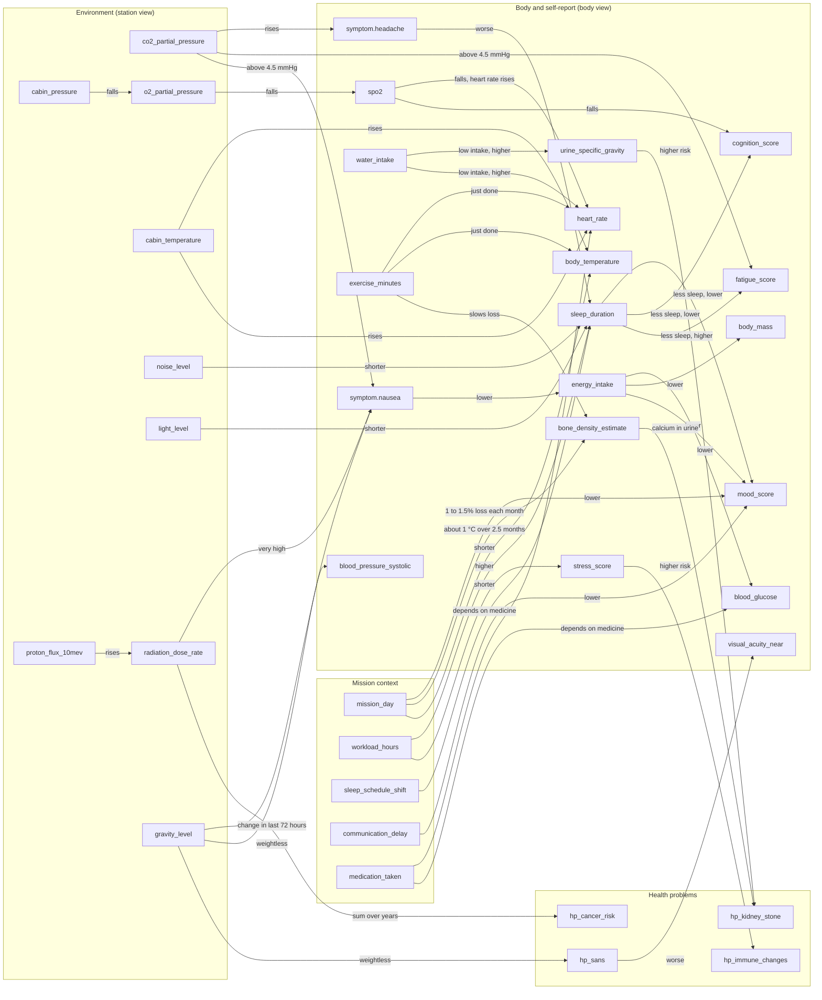

# Health indicator map

Knowledge base for the Nexxo views: body view, station view, charts view, and check-ups.

## 1. Purpose and how to read this document

This document maps causes, symptoms, and health problems of astronauts to the data that Nexxo can show.
Developers use it to write rules and seed data.
It starts from the five hazards of human spaceflight that the NASA Human Research Program names [S01].

Words that this document uses:

| Word | Meaning |
|---|---|
| Indicator | One value that the app stores over time. Each indicator has a stable id, for example `heart_rate`. |
| Symptom | One thing that a crew member feels and reports. Each symptom has an id that starts with `symptom.`, for example `symptom.headache`. |
| Health problem | A condition that a hazard drives. Each health problem has an id that starts with `hp_`, for example `hp_bone_loss`. |
| Hazard | One of the five NASA hazards. Each hazard has an id that starts with `hz_`. |
| Body region | A part of the body that the body view can mark. Each body region has an id that starts with `br_`. |
| Check-up | A short routine that the app starts when data looks wrong. The app asks for a measurement or for a symptom report. |
| Crew medical officer | The crew member with medical training who leads care on board. |
| Flight surgeons on the ground | The doctors in mission control who support the crew. |

How to read the marks:

- `[S01]` to `[S33]` point to a source in section 9. Each source has a URL.
- `(T)` means that the team chose the value for the prototype. No source gives this value.
- "Not confirmed" means that we could not check the claim today. Section 9 lists all these claims.
- Ranges have three levels. "Normal" needs no action. "Caution" starts a check-up. "Alert" needs the crew medical officer or the flight surgeons on the ground.
- Many body indicators change in flight for healthy people. So the app must compare each reading with the personal baseline of the crew member, and also with the fixed range.

The sections:

| Section | Content | Main user |
|---|---|---|
| 2 | Catalog of indicators with ids, units, and ranges | Seed data, charts view |
| 3 | Causes of a high or a low reading for each body indicator | Check-ups, body view |
| 4 | Map from hazard to health problem to indicator | Body view, station view |
| 5 | Relations between indicators, with a flowchart | Charts view (correlations) |
| 6 | Rules for check-ups | Check-ups |
| 7 | Data availability | Data layer |
| 8 | Limits of this document | All |
| 9 | Sources and claims that are not confirmed | All |

## 2. Catalog of indicators

The catalog has 46 indicators in four types: body, self-report, environment, and mission context.
The column "How often" is a team choice for the prototype in all rows.

### 2.1 Body indicators

| id | Type | Unit | How to measure in flight | How often | Normal range | Caution range | Alert range | What spaceflight does to it | Source |
|---|---|---|---|---|---|---|---|---|---|
| `heart_rate` | body | beats per minute, at rest | Wrist sensor, chest strap, or pulse oximeter (a finger clip that reads pulse and blood oxygen) | Continuous, or each morning at rest | 60 to 100. Trained people can have 40 to 60. | 50 to 59 or 101 to 120 (T), if this is not the personal baseline | Below 40 or above 120 at rest (T) | The 24-hour heart rate did not change in 8 astronauts on the station. The heart pumped about 35% more blood in each beat. | [S23] [S08] |
| `blood_pressure_systolic` | body | mmHg | Arm cuff, seated, after 5 minutes of rest | Weekly, and in a check-up | 90 to 119 | 120 to 139, or 85 to 89 (T) | 140 or more, or below 85 with symptoms (T). A value of 180 or more is an emergency (not confirmed). | The 24-hour blood pressure falls 8 to 10 mmHg in flight. | [S28] [S25] [S08] |
| `blood_pressure_diastolic` | body | mmHg | Same cuff reading as `blood_pressure_systolic` | Weekly, and in a check-up | 60 to 79 | 80 to 89, or 55 to 59 (T) | 90 or more, or below 55 with symptoms (T) | Falls together with `blood_pressure_systolic`. | [S28] [S25] [S08] |
| `blood_glucose` | body | mg/dL | Finger-prick meter. Record if the reading is fasting (no food for 8 hours). | Weekly fasting, and in a check-up | Fasting 70 to 99 | Fasting 100 to 125, or any reading 54 to 69 | Fasting 126 or more, any reading 200 or more, or any reading below 54 | An index of insulin resistance rose in 8 astronauts in 6-month flights. Insulin resistance means that the body answers less to insulin, so blood sugar can rise. Other studies do not agree. | [S27] [S31] [S18] |
| `body_temperature` | body | °C, oral or forehead | Thermometer | Daily, and in a check-up | Up to 37.2 at rest, or up to the personal baseline in flight plus 0.5 (T) | Above 37.5, or personal baseline plus 0.5 to 1.0 (T) | 39.4 or more, or personal baseline plus 1.0 or more for 48 hours (T) | Core temperature at rest rises about 1 °C in long flights. The rise builds over about 2.5 months. Temperature also rises faster in exercise. | [S24] [S10] |
| `spo2` | body | % (blood oxygen saturation) | Pulse oximeter | In a check-up, or continuous in sleep | 95 to 100 | 93 to 94 | 92 or less. 88 or less is an emergency. | No change is expected when the cabin air is normal. | [S26] |
| `heart_rate_variability` | body | ms (RMSSD, a standard measure of the change in time between heartbeats) | Chest strap or wrist sensor, in sleep or on waking | Daily | Personal baseline within 20% (T) | 20 to 40% below personal baseline for 3 days (T) | More than 40% below personal baseline for 3 days (T) | Not confirmed. One station study reports changes. | Not confirmed |
| `body_mass` | body | kg | Mass measurement device on the station (it uses a spring, because a scale does not work in weightlessness) | Every 2 weeks | Within 5% of preflight mass (T) | Loss of 5 to 10% (T) | Loss of more than 10% (T) | Crew often eat less than they need, and muscle shrinks. Calf muscle volume fell 13% in 6 months on the station, with exercise. | [S16] [S09] |
| `sleep_duration` | body | hours each day | Wrist sensor, or sleep log | Daily | 7 or more | 6.0 to 6.9 for 3 days (T) | Below 6.0 for 3 days, or below 5.0 for 1 night (T) | Station crew slept 6.09 hours on average. The schedule gave 8.5 hours. | [S29] [S06] |
| `urine_specific_gravity` | body | ratio (density of urine against water) | Urine test strip or small optical meter | Weekly, and in a check-up | 1.005 to 1.020 (T inside the normal range of the laboratory) | 1.021 to 1.030 (T) | Above 1.030 | Low water intake and bone loss raise the risk of kidney stones in flight. | [S30] [S13] |
| `urine_test_strip` | body | list of flags: blood, white cells, nitrite, protein, glucose, pH | Urine test strip, read by eye or by camera | Monthly, and in a check-up | All flags negative | One flag positive (T) | Blood positive with `symptom.flank_pain`, or white cells and nitrite positive with fever (T) | Bone loss puts more calcium in the urine. Infections can change urine pH. | [S13] |
| `cognition_score` | body | % of personal baseline | The NASA "Cognition" test set (10 short tests, about 16 minutes), or only its 3-minute reaction test | Weekly, and in a check-up | 90% or more of personal baseline (T) | 80 to 89% (T) | Below 80% in 2 tests in a row (T) | A night with no sleep made reaction slower and less exact in a ground study. | [S22] |
| `visual_acuity_near` | body | lines lost on a near vision chart, for each eye | Near vision chart on a tablet, each eye alone | Monthly, and in a check-up | 0 lines lost against preflight (T) | 1 line lost (T) | 2 or more lines lost, or a sudden change (T) | Spaceflight associated neuro-ocular syndrome (SANS) is a set of eye changes in weightlessness. It can swell the optic disc and make near vision worse. | [S11] |
| `eye_exam_finding` | body | category: none, mild, clear | Optical coherence tomography (a light scan of the back of the eye), eye ultrasound, or a photo of the back of the eye | At months 1, 3, and 6 (T), and in a check-up | none | mild | clear | About 60% of long-flight astronauts have one sign of SANS or more. About 15% have clear swelling of the optic disc. | [S11] |
| `ultrasound_finding` | body | category for each organ: none, suspect, clear | Ultrasound device on board, with guidance from the ground | In a check-up only | none | suspect | clear (for example a kidney stone or a blood clot in a neck vein) | Astronauts get an ultrasound or a magnetic resonance scan for kidney stones before flight. Blood clots in a neck vein in flight: not confirmed. | [S13] |
| `bone_density_estimate` | body | % of preflight bone density at the hip and the spine | The app computes it. A real scan is possible only on the ground. | The app updates it monthly | Loss below 1% each month (T) | Loss of 1 to 1.5% each month | Loss above 1.5% each month, or total loss above 10% (T) | Bone density falls 1 to 1.5% each month in weightlessness. | [S07] |
| `exercise_minutes` | body | minutes each day, split into resistance and aerobic | Log from the exercise machines, or a manual entry | Daily | 90% or more of the plan (T) | 50 to 89% of the plan for 3 days (T) | Below 50% of the plan for 3 days (T) | Station crew did aerobic exercise about 5 hours each week and resistance exercise 3 to 6 days each week, and still lost calf muscle. | [S16] [S15] |
| `energy_intake` | body | kcal each day, as % of the personal target | Food log, with barcode scan or photo | Daily | 90% or more of target (T) | 70 to 89% for 3 days (T) | Below 70% for 3 days (T) | Inadequate food and nutrition is a listed NASA risk. | [S09] |
| `water_intake` | body | litres each day | Drink log | Daily | 2.5 or more | 2.0 to 2.4 (T) | Below 2.0 for 2 days (T) | The NASA standard provides a minimum of 2.5 litres of drinking water for each crew member each day. | [S02] [S13] |

### 2.2 Self-report indicators

| id | Type | Unit | How to measure in flight | How often | Normal range | Caution range | Alert range | What spaceflight does to it | Source |
|---|---|---|---|---|---|---|---|---|---|
| `mood_score` | self-report | scale 1 (very low) to 5 (very good) (T) | One question in the app | Daily | 3 to 5 (T) | 2 for 3 days (T) | 1 on any day, or 2 or less for 5 days (T) | Isolation and confinement can change behavior in a small group over a long time. | [S01] [S09] |
| `stress_score` | self-report | scale 1 (calm) to 5 (very stressed) (T) | One question in the app | Daily | 1 to 3 (T) | 4 for 3 days (T) | 5 for 2 days (T) | Stress hormones in flight have a link with virus reactivation. | [S17] |
| `sleep_quality` | self-report | scale 1 (very bad) to 5 (very good) (T) | One question on waking | Daily | 3 to 5 (T) | 2 for 3 days (T) | 1 for 3 days (T) | Sleep loss, a shifted body clock, and work overload are one listed NASA risk. | [S09] |
| `fatigue_score` | self-report | scale 1 (fresh) to 5 (exhausted) (T) | One question in the app | Daily | 1 to 3 (T) | 4 for 2 days (T) | 5 on any day (T) | Fatigue occurs above 4.5 mmHg of CO2. | [S03] |
| `symptom_report` | self-report | symptom id, body region id, severity 0 to 10, start time | Tap on the body view, or answer in a check-up | When it occurs, and in a check-up | No report, or severity 1 to 2 (T) | Severity 3 to 5 (T) | Severity 6 or more, or any symptom marked "emergency" in section 2.5 (T) | See section 2.5. | (T) |

### 2.3 Environment indicators

The app stores each environment indicator for each module, when the data has a module.

| id | Type | Unit | How to measure in flight | How often | Normal range | Caution range | Alert range | What spaceflight does to it | Source |
|---|---|---|---|---|---|---|---|---|---|
| `co2_partial_pressure` | environment | mmHg | Cabin gas sensor. Station telemetry: `USLAB000055` (Lab), `NODE3000003` (Node 3). | Each minute. Store the 1-hour average and the 7-day average. | 7-day average below 2.5 | 7-day average 2.5 or more, or 1-hour average 2.8 to 3.0 | 1-hour average above 3.0. Above 4.5 the crew can get fatigue and nausea. | The cabin is closed, so CO2 from breath stays until the scrubbers remove it. CO2 can collect where air does not move. | [S02] [S03] [S32] |
| `o2_partial_pressure` | environment | mmHg. Convert to inspired O2 before you compare with the limits (see the note below). | Cabin gas sensor. Station telemetry: `USLAB000053` (Lab), `NODE3000001` (Node 3). | Each minute | Inspired O2 139 to 168 | Inspired O2 127 to 138, or 169 to 333 | Inspired O2 below 127 (T), or above 333 | Low O2 gives hypoxia (too little oxygen in the body). High O2 raises the fire risk. | [S02] [S32] |
| `cabin_pressure` | environment | mmHg (the standard gives kPa) | Cabin pressure sensor. Station telemetry: `USLAB000058`. | Each minute | 259 to 773 mmHg (34.5 to 103 kPa), and steady | A fall of 5 mmHg or more in 10 minutes (T) | Outside 259 to 773 mmHg, or a fall of 20 mmHg or more in 10 minutes (T) | A leak lowers the pressure. A fast fall can cause decompression sickness (gas bubbles in the body). | [S02] [S32] |
| `cabin_temperature` | environment | °C | Cabin sensor. Station telemetry: `USLAB000059`. | Each minute | 20 to 25 | 18 to 19.9, or 25.1 to 27 | Below 18 or above 27 | The limits depend on humidity: 18 °C at 75% humidity to 27 °C at 25% humidity. | [S02] [S32] |
| `cabin_humidity` | environment | % relative humidity | Cabin sensor | Each minute | 30 to 60 | 25 to 29, or 61 to 75 | Below 25 or above 75 | Low humidity dries eyes, skin, and airways. High humidity helps microbes to grow. | [S02] |
| `noise_level` | environment | dBA (sound level, weighted for the human ear) | Sound level meter in each module, or a personal dose meter | Each minute. Store the 24-hour dose. | Sleep areas below curve NC-40. Work areas below curve NC-50. | Sleep areas above 50 dBA, or work areas above 60 dBA (T, rough dBA values for the curves, not confirmed) | 85 dBA or more, or a 24-hour dose above the same dose as 8 hours at 75 dBA | Fans and pumps run all the time. Noise harms sleep and hearing. | [S02] |
| `light_level` | environment | lux, and hours of bright light each day | Light sensor in each module | Each 10 minutes | A steady 24-hour pattern of light and dark (T) | The light and dark pattern moves 1 to 2 hours in a day (T) | The pattern moves more than 2 hours, or bright light in the sleep period (T) | No natural 24-hour day exists in flight. The body clock can move. Exact light limits: not confirmed. | [S09] |
| `radiation_dose_rate` | environment | mSv each day | Cabin dosimeter and personal dosimeter | Each hour | 0.2 to 0.5 (normal for the station) | 0.5 to 1.0 (T) | Above 1.0, or any rise in a solar particle event (T) | The dose rate is much higher than on Earth. It is higher still outside low Earth orbit. | [S05] |
| `radiation_dose_cumulative` | environment | mSv, for each crew member | Sum of the personal dosimeter readings | Daily | Below 300 in the career (T, 50% of the limit) | 300 to 599 in the career (T) | 600 or more in the career, or 250 or more from one solar particle event | The NASA career limit is 600 mSv. The limit for one solar particle event is 250 mSv. | [S04] |
| `proton_flux_10mev` | environment | pfu (protons with 10 MeV or more, per cm² per second per steradian) | NOAA GOES satellite feed | Each 5 minutes | Below 10 | 10 to 999 (storm scale S1 or S2) | 1000 or more (storm scale S3 or more) (T mapping) | A solar particle event sends protons that raise the dose rate. Scale S3 means a radiation risk to astronauts on a spacewalk. | [S19] [S33] |
| `solar_radiation_storm_scale` | environment | S0 to S5 | NOAA scales feed | Each 5 minutes | S0 | S1 or S2 (T) | S3 or more (T) | The scale goes up one step for each 10 times more protons. S1 starts at 10 pfu and S5 at 100,000 pfu. | [S19] [S33] |
| `space_weather_event` | environment | event type: SEP (solar energetic particles), FLR (flare), CME (coronal mass ejection), GST (geomagnetic storm) | NASA DONKI feed | Each 15 minutes (T) | No event | FLR or CME reported (T) | SEP reported (T) | A flare or a coronal mass ejection can come before a solar particle event. | [S33] |
| `gravity_level` | environment | g (1 g is Earth surface gravity) | Set by the mission phase | When the phase changes | 1.0 | 0.17 (Moon) or 0.38 (Mars) (T) | 0 (weightless) for more than 30 days without the exercise plan (T) | Moon gravity is one-sixth of Earth gravity. Mars gravity is three-eighths. Weightlessness drives bone loss, muscle loss, fluid shift to the head, and motion sickness. | [S01] [S21] |
| `g_force` | environment | g, sustained | Accelerometer of the vehicle | Continuous in launch, landing, and engine burns | Up to 1.5 (T) | 1.5 to 4 (T) | Above 4 (T) | Launch and landing load the body after weeks of weakness. The NASA limits are in tables that we could not read. Typical launch and landing values: not confirmed. | [S02] |

Note on inspired O2. The NASA limits use the O2 pressure in the air that reaches the lungs. The telemetry gives the O2 pressure in the cabin.
Use this formula: inspired O2 = (`cabin_pressure` − 47) × (`o2_partial_pressure` ÷ `cabin_pressure`).
The number 47 is the pressure of water vapor in the lungs in mmHg.
For example, a cabin at 760 mmHg with 160 mmHg of O2 gives 150 mmHg of inspired O2.
The formula is standard physiology. The value 149 mmHg in [S02] for normal air agrees with it, but [S02] does not print the formula (not confirmed).

### 2.4 Mission context indicators

| id | Type | Unit | How to measure in flight | How often | Normal range | Caution range | Alert range | What spaceflight does to it | Source |
|---|---|---|---|---|---|---|---|---|---|
| `mission_day` | mission context | days from launch | App clock | Daily | No fixed range | No fixed range | No fixed range | Risks grow with time: bone loss each month, core temperature over 2.5 months, eye changes in long flights. A Mars mission takes about 3 years. | [S07] [S10] [S01] |
| `communication_delay` | mission context | minutes, one way | Computed from the distance to Earth | Daily | Below 1 (T) | 1 to 5 (T) | Above 5 (T). The ground cannot answer in real time. | The one-way delay on a Mars mission changes from 0 to 22 minutes. | [S20] |
| `workload_hours` | mission context | scheduled work hours each day | Mission schedule | Daily | Up to 8 (T) | 8 to 10 for 3 days (T) | Above 10 for 3 days (T) | Work overload is part of a listed NASA risk. | [S09] |
| `sleep_schedule_shift` | mission context | hours that the planned sleep time moved against the day before | Mission schedule | Daily | 0 to 1 (T) | 1 to 2 (T) | More than 2 (T) | Dockings and spacewalks move the sleep period. A shifted body clock is part of a listed NASA risk. | [S09] |
| `medication_taken` | mission context | medicine name, dose, time | Log in the app | When taken | Taken as planned | A missed dose, or a medicine in section 3.2 taken in the last 24 hours | A dose above the plan (T) | Medicines can lose effect in long flights. This is a listed NASA risk. | [S09] |
| `prior_condition` | mission context | list of conditions and past events for each crew member | Medical record, entered before flight and after each event | When it changes | Empty list | Any entry that section 3 names | Does not apply | A past kidney stone returns in about 60% of people on Earth. | [S13] |
| `time_of_day` | mission context | hours since waking | App clock and sleep log | With each reading | Does not apply | Does not apply | Does not apply | Body temperature changes in the day and is usually highest in the evening. | [S24] |
| `eva_recent` | mission context | hours since the last spacewalk | Mission schedule | When it changes | More than 24 | 0 to 24 | Does not apply | A spacewalk is hard physical work at low suit pressure. Injury and decompression sickness are listed NASA risks. | [S09] |

### 2.5 Symptom ids for `symptom_report`

Each symptom has a default body region. The body view marks that body region.

| Symptom id | Meaning | Default body region | Emergency |
|---|---|---|---|
| `symptom.headache` | Pain in the head | `br_head` | No |
| `symptom.nausea` | Feeling sick, or vomiting | `br_stomach` | No |
| `symptom.dizziness` | Feeling of spin or of fainting | `br_inner_ear` | No |
| `symptom.blurred_vision` | Vision is less sharp | `br_eyes` | Yes, if sudden |
| `symptom.congestion` | Blocked nose, full feeling in the face | `br_head` | No |
| `symptom.palpitations` | Fast, strong, or irregular heartbeat that the person feels | `br_heart` | No |
| `symptom.chest_pain` | Pain or pressure in the chest | `br_heart` | Yes |
| `symptom.shortness_of_breath` | Hard to breathe | `br_lungs` | Yes |
| `symptom.flank_pain` | Pain in the side of the lower back, a sign of a kidney stone | `br_kidneys` | No |
| `symptom.back_pain` | Pain in the spine or back muscles | `br_spine` | No |
| `symptom.muscle_weakness` | Less strength than usual | `br_legs` | No |
| `symptom.joint_pain` | Pain in a joint, a possible sign of decompression sickness after a pressure fall | `br_joints` | Yes, after a pressure fall |
| `symptom.skin_rash` | Red, itchy, or broken skin | `br_skin` | No |
| `symptom.ear_ringing` | Ringing sound in the ear, or worse hearing | `br_ears` | No |

### 2.6 Body region ids

| Body region id | Part or system |
|---|---|
| `br_head` | Head and brain |
| `br_eyes` | Eyes |
| `br_ears` | Ears and hearing |
| `br_inner_ear` | Balance organ in the inner ear |
| `br_heart` | Heart and blood vessels |
| `br_lungs` | Lungs and airways |
| `br_stomach` | Stomach and gut |
| `br_kidneys` | Kidneys and urinary system |
| `br_spine` | Spine and back |
| `br_hips` | Hip bones |
| `br_legs` | Leg muscles |
| `br_joints` | Joints |
| `br_skin` | Skin |
| `br_whole_body` | Whole body, for example the immune system and blood sugar control |

## 3. Causes of a high or a low reading

### 3.1 How to use this section

Each row gives possible causes for one reading that is too high or too low.
The check-up uses the row to choose its questions.
The app must check the context causes first, because they are the most common and the least serious.

The cause lists are common medical knowledge and starting points for rules. They are not a full medical list.
Each number in this section has a source. The cause lists as a whole are not confirmed against one source.

### 3.2 Medicines that change readings

The context causes below name these groups of medicines. The list is common medical knowledge (not confirmed against one source).

| Medicine group | Example use in flight | Readings that it can change |
|---|---|---|
| Motion sickness medicine | Space motion sickness | `heart_rate` up, `cognition_score` down, sleepiness |
| Decongestant | Blocked nose from the fluid shift to the head | `heart_rate` up, `blood_pressure_systolic` up, `sleep_duration` down |
| Sleep medicine | Sleep loss | `cognition_score` down after waking, `heart_rate` down |
| Stimulant, including caffeine | Fatigue | `heart_rate` up, `blood_pressure_systolic` up, `sleep_duration` down |
| Steroid (for example prednisone) | Rash, allergy, inflammation | `blood_glucose` up, `mood_score` change, `sleep_duration` down |
| Insulin or other diabetes medicine | Diabetes | `blood_glucose` down |
| Beta blocker | High blood pressure, heart rhythm | `heart_rate` down, `blood_pressure_systolic` down, can hide the signs of low `blood_glucose` |
| Pain medicine and fever medicine | Headache, back pain | `body_temperature` down (hides a fever) |
| Water tablet (diuretic) | High blood pressure | `urine_specific_gravity` down, `blood_pressure_systolic` down, `body_mass` down |

### 3.3 Cause tables

| Indicator | Reading | Body causes | Environment causes | Context causes |
|---|---|---|---|---|
| `heart_rate` | Too high | Dehydration (low `water_intake`). Fever or infection. Low `blood_glucose`. Low `spo2`. Low `energy_intake` over weeks. Anxiety or high `stress_score`. Pain. Heart rhythm problem. Loss of fitness. Blood loss. | High `co2_partial_pressure`. Low `o2_partial_pressure`. High `cabin_temperature`. High `g_force`. Change of `gravity_level` in the last 72 hours. | Exercise in the last 30 minutes. Stimulant or decongestant in `medication_taken`. Reading soon after waking or after a meal. `eva_recent` below 24 hours. Short `sleep_duration` the night before. Heart or thyroid condition in `prior_condition`. |
| `heart_rate` | Too low | Very good fitness (40 to 60 can be normal [S23]). Heart rhythm problem. Low `body_temperature`. Very low `energy_intake` over weeks. | Low `cabin_temperature`. | Beta blocker or sleep medicine in `medication_taken`. Reading in sleep. Heart condition in `prior_condition`. |
| `blood_pressure_systolic` and `blood_pressure_diastolic` | Too high | Pain. High `stress_score`. Full bladder. Kidney problem. Too much salt in food. | High `noise_level`. High `g_force`. High `co2_partial_pressure`. | Exercise in the last 30 minutes. Stimulant, decongestant, or steroid in `medication_taken`. No rest before the reading. Wrong cuff position. High blood pressure in `prior_condition`. |
| `blood_pressure_systolic` and `blood_pressure_diastolic` | Too low | Dehydration. Blood loss. Infection. Low `energy_intake`. Heart problem. Normal fall of 8 to 10 mmHg in flight [S08]. | High `cabin_temperature`. Return to gravity after weightlessness (the blood moves to the legs when the person stands). | Beta blocker, water tablet, or sleep medicine in `medication_taken`. Reading just after standing up in gravity. Reading after a long exercise session. |
| `blood_glucose` | Too high | Insulin resistance, which can grow in flight [S18]. Infection or fever. High `stress_score`. Diabetes or early diabetes. Little `exercise_minutes` over weeks. | No direct cause. Short `sleep_duration` from `noise_level` or `light_level` can add to it. | Meal or sweet drink in the last 2 hours (reading is not fasting). Steroid in `medication_taken`. Diabetes in `prior_condition`. Missed diabetes medicine. Sugar on the finger at the test. |
| `blood_glucose` | Too low | Low `energy_intake` (missed meals, nausea, malnutrition). Long or hard exercise. Infection in a severe case. Liver or hormone problem. | Space motion sickness after a change of `gravity_level`, because the person cannot eat. | Insulin or diabetes medicine in `medication_taken`. Long time since the last meal. Exercise in the last 2 hours. `eva_recent` below 24 hours. A low reading reported before in `prior_condition`. |
| `body_temperature` | Too high | Infection. Virus reactivation. Inflammation. Dehydration. Normal rise of about 1 °C in long flights [S10]. | High `cabin_temperature`. High `cabin_humidity` (sweat does not dry). Weak air flow (in weightlessness warm air does not rise from the skin). | Exercise in the last 60 minutes (temperature rises faster in flight [S10]). Evening reading [S24]. `eva_recent` below 24 hours. Second half of the menstrual cycle [S24]. |
| `body_temperature` | Too low | Very low `energy_intake`. Thyroid problem. Severe infection in some people. | Low `cabin_temperature`. Suit cooling fault in a spacewalk. | Fever medicine in `medication_taken`. Reading just after a cold drink (oral). Wrong sensor position. Early morning reading. |
| `spo2` | Too low | Lung infection. Asthma or airway swelling. Blood clot in the lung. Heart problem. Shallow breathing in sleep. | Low `o2_partial_pressure`. Fall of `cabin_pressure`. Smoke or a toxic gas leak. | Cold finger or movement at the test. Nail polish. Sleep medicine or strong pain medicine in `medication_taken`. Lung condition in `prior_condition`. Readings can be 2 to 4% off [S26]. |
| `spo2` | Too high | Does not apply. 100% is normal. | High `o2_partial_pressure` (for example pure oxygen before a spacewalk). | Does not apply. |
| `heart_rate_variability` | Too low | High `stress_score`. Short `sleep_duration`. Infection that starts. Too much training. Dehydration. | High `co2_partial_pressure` (not confirmed). High `cabin_temperature`. High `noise_level` in sleep. | Alcohol does not apply in flight. Stimulant in `medication_taken`. Hard exercise the day before. `sleep_schedule_shift` above 2 hours. |
| `heart_rate_variability` | Too high | Good recovery. A heart rhythm problem can give a false high value. | No known cause. | Sensor error. Beta blocker in `medication_taken`. |
| `body_mass` | Too low (falls) | Low `energy_intake`. Muscle loss [S16]. Dehydration. Nausea and vomiting. Low `mood_score` with low appetite. | Change of `gravity_level` (fluid loss in the first days, motion sickness). High `co2_partial_pressure` with nausea. | Little `exercise_minutes` (resistance). Water tablet in `medication_taken`. High `workload_hours` with missed meals. Device error. |
| `body_mass` | Too high (rises) | `energy_intake` above need. Fluid kept in the body. | No known cause. | Steroid in `medication_taken`. Little `exercise_minutes` (aerobic). Device error. |
| `sleep_duration` | Too low | Pain (`symptom.back_pain`, `symptom.headache`). `symptom.congestion`. High `stress_score`. Low `mood_score`. Need to urinate at night. | High `noise_level`. Wrong `light_level` pattern. High `co2_partial_pressure` in the sleep area. `cabin_temperature` outside 20 to 25 °C. | High `workload_hours`. `sleep_schedule_shift`. Stimulant, decongestant, or steroid in `medication_taken`. Exercise late in the day. Important task the next day. |
| `sleep_duration` | Too high | Infection. Low `mood_score`. Recovery after sleep loss. | High `co2_partial_pressure` (fatigue above 4.5 mmHg [S03]). | Sleep medicine or motion sickness medicine in `medication_taken`. Rest day. |
| `urine_specific_gravity` | Too high | Dehydration (low `water_intake`). Vomiting. Heavy sweat. Glucose or protein in the urine. | High `cabin_temperature`. Low `cabin_humidity`. | First urine of the morning. Exercise in the last 2 hours. `eva_recent` below 24 hours. Kidney stone in `prior_condition` makes this reading more important. |
| `urine_specific_gravity` | Too low | Very high `water_intake`. Kidney problem. | No known cause. | Water tablet in `medication_taken`. Much caffeine. |
| `cognition_score` | Too low | Short `sleep_duration`. Low `blood_glucose`. Low `spo2`. Fever. Low `mood_score` or high `stress_score`. `symptom.headache`. Dehydration. | High `co2_partial_pressure` (not confirmed, studies do not agree). Low `o2_partial_pressure`. High `noise_level`. High `radiation_dose_rate` in a solar particle event. | Sleep medicine or motion sickness medicine in `medication_taken`. Test soon after waking. `sleep_schedule_shift`. High `workload_hours`. Test done in a hurry. |
| `cognition_score` | Too high | Does not apply. | Does not apply. | Practice effect. Scores rise when a person repeats the test [S22]. |
| `visual_acuity_near` | Worse | SANS [S11]. Normal ageing of the eye. Dry eye. High `blood_glucose`. Migraine. | Weightlessness (`gravity_level` 0) over weeks. Low `cabin_humidity` (dry eye). Dim `light_level` at the test. High `co2_partial_pressure` as a possible partner of SANS (not confirmed). | Test without the usual glasses. Tired eyes after screen work. Eye condition in `prior_condition`. `mission_day` above 30. |
| `mood_score` | Too low | Short `sleep_duration`. Pain. Illness. Low `energy_intake`. | High `co2_partial_pressure` with `symptom.headache`. High `noise_level`. Wrong `light_level` pattern. | High `workload_hours`. High `communication_delay` (less contact with family). High `mission_day`. Conflict in the crew. Bad news from home. Steroid in `medication_taken`. Mood condition in `prior_condition`. |

## 4. Map from hazard to health problem to indicator

NASA lists 22 risks in the Human Research Roadmap [S09]. The column "NASA risk" gives the matching risk in short words.
The five hazards come from [S01].

### 4.1 `hz_radiation`: space radiation

| Health problem id | Health problem | NASA risk | Indicators that show it | Body region | Countermeasure or crew action |
|---|---|---|---|---|---|
| `hp_radiation_acute` | Acute radiation effects from a solar particle event: nausea, fatigue, skin changes | Medical conditions in mission | `proton_flux_10mev`, `solar_radiation_storm_scale`, `space_weather_event`, `radiation_dose_rate`, `symptom.nausea`, `fatigue_score`, `symptom.skin_rash` | `br_stomach`, `br_skin`, `br_whole_body` | Go to the shelter area. Stop or delay a spacewalk. Log the dose. Report symptoms at 6 and 24 hours. |
| `hp_cancer_risk` | Higher cancer risk later in life | Radiation carcinogenesis | `radiation_dose_cumulative` | `br_whole_body` | Keep the dose low: sleep in the best shielded place, follow shelter alerts. Flight surgeons on the ground track the career dose against 600 mSv [S04]. |
| `hp_radiation_cns` | Possible effects on the brain: slower thinking, mood change (evidence in humans: not confirmed) | Cognitive or behavioral changes | `cognition_score`, `mood_score`, `radiation_dose_cumulative` | `br_head` | Do the cognition test on schedule. Compare with the personal baseline. |
| `hp_immune_changes` | Immune system changes (radiation is one of several drivers) | Altered immune response | `body_temperature`, `symptom.skin_rash`, `stress_score`, `sleep_duration` | `br_whole_body`, `br_skin` | See section 4.2. |

### 4.2 `hz_isolation`: isolation and confinement

| Health problem id | Health problem | NASA risk | Indicators that show it | Body region | Countermeasure or crew action |
|---|---|---|---|---|---|
| `hp_behavioral_health` | Low mood, anxiety, loss of drive | Cognitive or behavioral changes and psychiatric disorders | `mood_score`, `stress_score`, `sleep_quality`, `energy_intake`, `exercise_minutes` | `br_head` | Daily mood check. Private talk with the crew medical officer or with the ground. Contact with family. Free time. Exercise. |
| `hp_sleep_loss` | Sleep loss and a shifted body clock | Sleep loss, circadian desynchronization, and work overload | `sleep_duration`, `sleep_quality`, `fatigue_score`, `cognition_score`, `light_level`, `sleep_schedule_shift`, `workload_hours`, `noise_level` | `br_head` | Keep a fixed sleep time. Bright light after waking and dim light before sleep. Lower noise in the sleep area. Lower the workload. |
| `hp_cognitive_decline` | Slower reaction, more errors | Cognitive or behavioral changes | `cognition_score`, `sleep_duration`, `fatigue_score` | `br_head` | Repeat the test after sleep. Move critical tasks. Check the cabin air. |
| `hp_team_conflict` | Poor cooperation in the crew | Inadequate cooperation and psychosocial adaptation within a team | `mood_score`, `stress_score` (crew trend, not one person) | `br_head` | Crew meeting. Support from the ground. NASA names selection, training, and support as the countermeasures [S01]. |
| `hp_immune_changes` | Immune system changes and reactivation of sleeping viruses. 14 of 23 station astronauts (61%) shed a herpes virus in saliva or urine, usually with no symptoms [S17]. | Altered immune response | `stress_score`, `sleep_duration`, `body_temperature`, `symptom.skin_rash`, `energy_intake` | `br_whole_body`, `br_skin` | Lower stress. Protect sleep. Eat the full diet. Report rash, cold sores, or fever. |

### 4.3 `hz_distance`: distance from Earth

| Health problem id | Health problem | NASA risk | Indicators that show it | Body region | Countermeasure or crew action |
|---|---|---|---|---|---|
| `hp_delayed_care` | Medical help comes late, and return to Earth is not possible in time | Earth independent human-systems operations. Medical conditions in mission. | `communication_delay`, `mission_day`, all alert-level readings | `br_whole_body` | The crew medical officer leads. The app shows the stored procedure. The app sends a data package to the flight surgeons on the ground. |
| `hp_inadequate_nutrition` | Inadequate nutrition, because all food is packed and old, and no supply comes | Inadequate food and nutrition | `energy_intake`, `body_mass`, `water_intake`, `blood_glucose`, `mood_score` | `br_stomach`, `br_whole_body` | Log food. Eat the planned menu. Take planned supplements. Report low appetite. |
| `hp_medicine_problem` | Medicines lose effect or run out | Ineffective or toxic medications | `medication_taken`, a symptom that does not improve after a medicine | `br_whole_body` | Log each medicine and its effect. Report a medicine that does not work. |
| `hp_behavioral_health` | Low mood from less contact with home | Cognitive or behavioral changes | `mood_score`, `communication_delay` | `br_head` | Recorded messages with family. Planned contact times. |

### 4.4 `hz_gravity`: gravity fields

| Health problem id | Health problem | NASA risk | Indicators that show it | Body region | Countermeasure or crew action |
|---|---|---|---|---|---|
| `hp_bone_loss` | Bone density loss of 1 to 1.5% each month [S07] | Bone fracture | `bone_density_estimate`, `exercise_minutes` (resistance), `energy_intake`, `urine_test_strip`, `mission_day` | `br_hips`, `br_spine` | Resistance exercise on schedule. Full diet with the planned vitamin D and calcium. |
| `hp_muscle_loss` | Muscle loss and lower fitness. Calf muscle volume fell 13% in 6 months [S16]. | Reduced cardiorespiratory and musculoskeletal fitness | `exercise_minutes`, `body_mass`, `symptom.muscle_weakness`, `heart_rate` in exercise | `br_legs`, `br_spine` | Resistance and aerobic exercise on schedule. Enough protein and energy. |
| `hp_cardiovascular_change` | Changes of the heart and blood vessels: lower blood pressure in flight, fainting after return to gravity, heart rhythm events | Cardiovascular adaptations | `blood_pressure_systolic`, `blood_pressure_diastolic`, `heart_rate`, `heart_rate_variability`, `symptom.palpitations`, `symptom.dizziness`, `symptom.chest_pain` | `br_heart` | Aerobic exercise. Drink enough. Before return to gravity, drink water with salt as planned. After landing, stand up slowly. |
| `hp_sans` | Spaceflight associated neuro-ocular syndrome (SANS) | SANS | `visual_acuity_near`, `eye_exam_finding`, `symptom.blurred_vision`, `symptom.headache`, `mission_day` | `br_eyes` | Monthly near vision check. Eye scan on schedule. Use the stronger reading glasses that the mission packs. The flight surgeons on the ground read the images. |
| `hp_kidney_stone` | Kidney stone. Bone loss puts calcium in the urine [S13]. | Renal stone formation | `water_intake`, `urine_specific_gravity`, `urine_test_strip`, `symptom.flank_pain`, `ultrasound_finding`, `prior_condition` | `br_kidneys` | Drink 2.5 litres or more each day [S02]. Resistance exercise. Kidney ultrasound if pain occurs. Citrate medicine if the flight surgeons on the ground prescribe it. |
| `hp_space_motion_sickness` | Space motion sickness: nausea and vomiting in the first 2 to 4 days after a gravity change [S14]. 67% of 85 people had it on a first Shuttle flight [S12]. | Altered sensorimotor and vestibular function | `symptom.nausea`, `symptom.dizziness`, `energy_intake`, `water_intake`, `mission_day`, `gravity_level` | `br_inner_ear`, `br_stomach` | Move the head slowly. Take the motion sickness medicine as planned. Eat and drink small amounts often. Delay critical tasks. |
| `hp_fluid_shift` | Body fluid moves to the head: full face, blocked nose, headache | SANS. Cardiovascular adaptations. | `symptom.congestion`, `symptom.headache`, `body_mass` | `br_head` | Decongestant as planned. Report a headache that stays. |
| `hp_back_pain` | Back pain, because the spine gets longer in weightlessness (numbers not confirmed) | Medical conditions in mission | `symptom.back_pain`, `sleep_duration` | `br_spine` | Stretch in a curled position. Exercise. Pain medicine as planned. |
| `hp_landing_load` | Injury or fainting from high g force after weeks of weakness | Dynamic loads | `g_force`, `heart_rate`, `blood_pressure_systolic`, `symptom.dizziness` | `br_heart`, `br_spine` | Correct seat position. Drink before landing as planned. Report symptoms after landing. |

### 4.5 `hz_environment`: hostile closed environments

| Health problem id | Health problem | NASA risk | Indicators that show it | Body region | Countermeasure or crew action |
|---|---|---|---|---|---|
| `hp_co2_headache` | Headache, then fatigue and nausea, from CO2 | Medical conditions in mission | `co2_partial_pressure`, `symptom.headache`, `fatigue_score`, `symptom.nausea`, `cognition_score`, `sleep_quality` | `br_head` | Move to a module with lower CO2. Raise the air flow. Check the CO2 scrubber. Do not sleep in a place with still air. |
| `hp_hypoxia` | Too little oxygen in the body | Hypoxia | `o2_partial_pressure`, `cabin_pressure`, `spo2`, `heart_rate`, `symptom.shortness_of_breath`, `symptom.headache`, `cognition_score` | `br_lungs`, `br_head` | Measure `spo2`. Use an oxygen mask. Move to another module. Tell the ground at once. |
| `hp_decompression_sickness` | Gas bubbles in the body after a pressure fall or a spacewalk | Decompression sickness | `cabin_pressure`, `eva_recent`, `symptom.joint_pain`, `symptom.skin_rash`, `symptom.shortness_of_breath` | `br_joints`, `br_lungs` | Breathe oxygen. Tell the crew medical officer and the ground at once. |
| `hp_heat_strain` | Body too hot or too cold | Medical conditions in mission | `cabin_temperature`, `cabin_humidity`, `body_temperature`, `heart_rate`, `water_intake` | `br_whole_body` | Drink. Rest. Raise the air flow. Change the temperature setting. |
| `hp_dry_air_effects` | Dry eyes, dry skin, nose bleed | Medical conditions in mission | `cabin_humidity`, `symptom.skin_rash`, `symptom.blurred_vision` | `br_skin`, `br_eyes` | Eye drops and skin cream as planned. Drink enough. |
| `hp_hearing_loss` | Hearing loss and poor sleep from noise | Medical conditions in mission | `noise_level`, `symptom.ear_ringing`, `sleep_duration` | `br_ears` | Wear hearing protection in loud places. Lower the noise in the sleep area. |
| `hp_sleep_loss` | Sleep loss from noise, light, heat, and CO2 | Sleep loss, circadian desynchronization, and work overload | `noise_level`, `light_level`, `cabin_temperature`, `co2_partial_pressure`, `sleep_duration` | `br_head` | See section 4.2. |
| `hp_infection` | Infection from microbes that stay in a closed cabin, with a changed immune system | Host-microorganism interactions | `body_temperature`, `heart_rate`, `symptom.skin_rash`, `urine_test_strip`, `cabin_humidity` | `br_whole_body` | Hand and surface cleaning. Report fever. NASA monitors the microbes on the station [S01]. |
| `hp_dust_exposure` | Irritation of lungs, eyes, and skin from Moon or Mars dust | Celestial dust exposure | `symptom.shortness_of_breath`, `spo2`, `symptom.skin_rash`, `eva_recent` | `br_lungs`, `br_eyes`, `br_skin` | Clean the suits before entry. Use the air filter. Report cough or eye pain. |

## 5. Relations

### 5.1 Table of relations

How to read the columns:

- Direction "same" means that the effect rises when the cause rises. Direction "opposite" means that the effect falls when the cause rises.
- Delay is the usual time from the change of the cause to the change of the effect.
- Strength of evidence: "strong" means a NASA limit or a measured result in astronauts. "Medium" means a result in a small study or in ground studies. "Weak" means common medical knowledge, or studies that do not agree. "Team guess" means that the team expects the relation but has no source.
- An id in the cause or effect column can be an indicator, a symptom, or a health problem.

| Relation id | Cause id | Effect id | Direction | Delay | Strength of evidence | Source |
|---|---|---|---|---|---|---|
| R01 | `co2_partial_pressure` | `symptom.headache` | same | Hours to days | Strong. Headaches occur at 2.8 to 4.5 mmHg. | [S03] |
| R02 | `co2_partial_pressure` | `fatigue_score` | same | Hours | Strong above 4.5 mmHg | [S03] |
| R03 | `co2_partial_pressure` | `symptom.nausea` | same | Hours | Strong above 4.5 mmHg | [S03] |
| R04 | `co2_partial_pressure` | `heart_rate` | same | Minutes to hours | Weak | Not confirmed |
| R05 | `co2_partial_pressure` | `cognition_score` | opposite | Hours | Weak. Studies do not agree. | Not confirmed |
| R06 | `co2_partial_pressure` | `sleep_quality` | opposite | Same night | Team guess | Not confirmed |
| R07 | `symptom.headache` | `sleep_quality` | opposite | Same night | Team guess | Not confirmed |
| R08 | `symptom.headache` | `mood_score` | opposite | Same day | Team guess | Not confirmed |
| R09 | `sleep_duration` | `cognition_score` | same | Next day | Strong | [S22] |
| R10 | `sleep_duration` | `mood_score` | same | Next day | Medium | [S09] |
| R11 | `sleep_duration` | `fatigue_score` | opposite | Next day | Medium | [S09] |
| R12 | `sleep_duration` | `heart_rate_variability` | same | Next day | Weak | Not confirmed |
| R13 | `noise_level` | `sleep_duration` | opposite | Same night | Medium. NASA sets a lower noise limit for sleep areas. | [S02] |
| R14 | `noise_level` | `symptom.ear_ringing` | same | Hours for loud noise, months for steady noise | Strong at 85 dBA or more | [S02] |
| R15 | `light_level` (pattern moves) | `sleep_duration` | opposite | 1 to 3 days | Medium | [S09] |
| R16 | `sleep_schedule_shift` | `sleep_duration` | opposite | Same night | Medium | [S09] |
| R17 | `workload_hours` | `sleep_duration` | opposite | Same night | Medium | [S09] |
| R18 | `workload_hours` | `stress_score` | same | Days | Medium | [S09] |
| R19 | `cabin_temperature` | `sleep_quality` | opposite, when outside 20 to 25 °C | Same night | Weak | [S02] |
| R20 | `cabin_temperature` | `body_temperature` | same | Hours | Medium | [S02] |
| R21 | `cabin_temperature` | `heart_rate` | same | Minutes to hours | Weak | Not confirmed |
| R22 | `cabin_humidity` | `hp_dry_air_effects` | opposite | Days | Medium. NASA keeps humidity above 25%. | [S02] |
| R23 | `cabin_pressure` | `o2_partial_pressure` | same | At once | Strong (physics) | [S02] |
| R24 | `cabin_pressure` (fast fall) | `hp_decompression_sickness` | opposite | Minutes to hours | Strong | [S02] [S09] |
| R25 | `o2_partial_pressure` | `spo2` | same | Minutes | Strong | [S02] |
| R26 | `spo2` | `heart_rate` | opposite | Minutes | Weak (common medical knowledge) | Not confirmed |
| R27 | `spo2` | `cognition_score` | same | Minutes | Medium | [S09] |
| R28 | `proton_flux_10mev` | `radiation_dose_rate` | same | Minutes to hours | Strong | [S19] [S04] |
| R29 | `radiation_dose_rate` | `radiation_dose_cumulative` | same | At once (it is the sum) | Strong | [S04] |
| R30 | `radiation_dose_rate` (very high, in a solar particle event) | `symptom.nausea` | same | Hours | Medium. The 250 mSv limit exists to prevent acute effects. | [S04] |
| R31 | `radiation_dose_cumulative` | `hp_cancer_risk` | same | Years | Strong | [S04] |
| R32 | `gravity_level` (change in the last 72 hours) | `symptom.nausea` | same | Hours. It lasts 2 to 4 days. | Strong | [S12] [S14] |
| R33 | `gravity_level` (weightless) | `blood_pressure_systolic` | Falls 8 to 10 mmHg in weightlessness | Weeks | Strong | [S08] |
| R34 | `gravity_level` (weightless) | `hp_sans` | Risk rises in weightlessness | Months | Strong | [S11] |
| R35 | `gravity_level` (weightless) | `symptom.congestion` | Occurs in weightlessness | Hours | Medium | [S01] |
| R36 | `gravity_level` (return to gravity) | `symptom.dizziness` | Occurs after return | Minutes after standing | Strong | [S09] |
| R37 | `mission_day` | `bone_density_estimate` | opposite, 1 to 1.5% each month | Months | Strong | [S07] |
| R38 | `exercise_minutes` | `bone_density_estimate` | same (slows the loss) | Months | Strong | [S15] [S07] |
| R39 | `mission_day` | `body_mass` (muscle part) | opposite | Months | Strong | [S16] |
| R40 | `exercise_minutes` | `symptom.muscle_weakness` | opposite | Weeks | Strong | [S16] [S15] |
| R41 | `mission_day` | `body_temperature` | same, about 1 °C over 2.5 months | Months | Medium | [S10] |
| R42 | `exercise_minutes` (session just done) | `body_temperature` | same | Minutes | Medium | [S10] |
| R43 | `exercise_minutes` (session just done) | `heart_rate` | same | Minutes | Strong (common medical knowledge) | Not confirmed |
| R44 | `mission_day` | `blood_glucose` | same (insulin resistance) | Months | Weak. Studies do not agree. | [S18] |
| R45 | `mission_day` | `visual_acuity_near` | Worse with time | Months | Strong | [S11] |
| R46 | `hp_sans` | `symptom.blurred_vision` | same | Weeks to months | Strong | [S11] |
| R47 | `bone_density_estimate` (loss) | `hp_kidney_stone` | Risk rises when bone is lost | Weeks to months | Strong | [S13] |
| R48 | `water_intake` | `urine_specific_gravity` | opposite | Hours | Strong (common medical knowledge) | [S30] |
| R49 | `urine_specific_gravity` | `hp_kidney_stone` | same | Weeks | Medium | [S13] |
| R50 | `water_intake` | `heart_rate` | opposite | Hours | Weak (common medical knowledge) | Not confirmed |
| R51 | `energy_intake` | `body_mass` | same | Weeks | Strong | [S09] |
| R52 | `energy_intake` | `blood_glucose` | same | Hours | Strong (common medical knowledge) | [S27] |
| R53 | `energy_intake` | `mood_score` | same | Days | Weak | Not confirmed |
| R54 | `symptom.nausea` | `energy_intake` | opposite | Same day | Team guess | Not confirmed |
| R55 | `medication_taken` | `heart_rate`, `blood_pressure_systolic`, `blood_glucose`, `cognition_score` | Depends on the medicine. See section 3.2. | Hours | Strong (common medical knowledge) | Not confirmed |
| R56 | `stress_score` | `hp_immune_changes` | same | Days to weeks | Medium | [S17] |
| R57 | `stress_score` | `heart_rate_variability` | opposite | Hours to days | Weak | Not confirmed |
| R58 | `communication_delay` | `mood_score` | opposite | Weeks | Team guess | [S01] |
| R59 | `mission_day` | `mood_score` | opposite | Months | Weak | [S01] |
| R60 | `eva_recent` (spacewalk in the last 24 hours) | `fatigue_score` | same | Hours | Medium | [S09] |
| R61 | `g_force` | `heart_rate` | same | Seconds | Weak (common medical knowledge) | Not confirmed |
| R62 | `mood_score` | `exercise_minutes` | same | Days | Team guess | Not confirmed |

### 5.2 Flowchart of the main relations

The flowchart shows the main chains across the views.
The station view owns the environment boxes. The body view owns the body boxes and the symptom boxes.

### 5.3 Chains across views

Each chain is a story that the charts view can show as linked charts.

| Chain id | Steps | Relations used |
|---|---|---|
| CH1 | `co2_partial_pressure` rises in one module. Crew in that module report `symptom.headache`. `sleep_quality` and `sleep_duration` fall that night. `mood_score` and `cognition_score` fall the next day. | R01, R07, R09, R10 |
| CH2 | `cabin_pressure` falls. `o2_partial_pressure` falls. `spo2` falls. `heart_rate` rises and `cognition_score` falls. | R23, R25, R26, R27 |
| CH3 | `proton_flux_10mev` rises. `radiation_dose_rate` rises. `radiation_dose_cumulative` rises. In a very strong event the crew report `symptom.nausea` and a high `fatigue_score`. | R28, R29, R30 |
| CH4 | `gravity_level` changes. The crew report `symptom.nausea`. `energy_intake` and `water_intake` fall. `blood_glucose` falls and `urine_specific_gravity` rises. | R32, R54, R52, R48 |
| CH5 | `mission_day` grows and `exercise_minutes` stay low. `bone_density_estimate` falls. With low `water_intake`, `urine_specific_gravity` rises. The risk of `hp_kidney_stone` rises and the crew member reports `symptom.flank_pain`. | R37, R38, R47, R48, R49 |
| CH6 | `workload_hours` and `sleep_schedule_shift` rise. `sleep_duration` falls. `stress_score` rises. `mood_score` and `cognition_score` fall. The risk of `hp_immune_changes` rises. | R16, R17, R18, R09, R10, R56 |
| CH7 | `noise_level` is high in the sleep area. `sleep_duration` falls. `fatigue_score` rises and `heart_rate_variability` falls. | R13, R11, R12 |
| CH8 | `mission_day` passes 30 in weightlessness. `visual_acuity_near` gets worse and the crew member reports `symptom.blurred_vision`. An eye scan gives an `eye_exam_finding`. | R34, R45, R46 |

## 6. Rules for check-ups

### 6.1 Levels of attention

| Level id | Who acts | When |
|---|---|---|
| `self` | The crew member | A reading is in the caution range and a context cause explains it. The crew member follows the advice and measures again. |
| `cmo` | The crew medical officer | A reading is in the alert range, a caution reading stays after the second measurement, or the rule says so. |
| `ground` | The flight surgeons on the ground | The rule says so, the crew medical officer asks for it, or an environment limit is broken and the crew cannot correct it. |

Notes about the levels:

- If `communication_delay` is above 5 minutes (T), the ground cannot answer in real time. Then the crew medical officer acts first and the app sends the data to the ground (rule C16).
- If the crew member with the problem is the crew medical officer, the app asks the next trained crew member.
- A symptom marked "emergency" in section 2.5 goes to `cmo` and `ground` at once, without a rule.

### 6.2 Trigger rules

Each rule joins an environment reading or a mission context reading with a body reading or a symptom report.
All thresholds that have no source in section 2 are team choices (T).

| Rule id | If (trigger) | Then ask (check-up) | Advice for the crew member | Needs `cmo` when | Needs `ground` when |
|---|---|---|---|---|---|
| C01 | The 1-hour average of `co2_partial_pressure` in a module is above 3.0 mmHg, and a crew member is in that module | Ask each crew member in the module: "Do you have a headache? Rate it from 0 to 10." Ask for `fatigue_score` and `symptom.nausea`. | Move to a module with lower CO2. Raise the air flow. | `symptom.headache` is 6 or more, or it comes with `symptom.nausea` | CO2 is above 4.5 mmHg, or the crew cannot lower CO2 in 2 hours |
| C02 | The 7-day average of `co2_partial_pressure` is 2.5 mmHg or more, and `sleep_duration` is below 6 hours for 2 nights | Ask on waking: "Did you wake with a headache?" Ask for `sleep_quality`. Ask where the crew member slept. | Check the air flow in the sleep area. Sleep in another place for one night and compare. | The headache on waking occurs 3 days in a row | The 7-day average stays at 2.5 mmHg or more for 14 days |
| C03 | Inspired O2 from `o2_partial_pressure` is below 139 mmHg, and resting `heart_rate` is 15 or more above the personal baseline, or the crew member reports `symptom.headache`, `symptom.dizziness`, or `symptom.shortness_of_breath` | Ask to measure `spo2` now and again after 5 minutes. | Rest. If `spo2` is 94 or less, move to another module. | `spo2` is 92 or less | `spo2` is 88 or less, or inspired O2 is below 127 mmHg. Use the oxygen mask and treat as an emergency. |
| C04 | `cabin_pressure` falls 5 mmHg or more in 10 minutes | Ask all crew to measure `spo2`. Ask: "Do you have ear pain, joint pain, or trouble with breathing?" | Follow the leak procedure of the vehicle. | Any `symptom.joint_pain`, `symptom.shortness_of_breath`, or `spo2` of 92 or less | Always. A pressure fall is a vehicle emergency. |
| C05 | `proton_flux_10mev` is 10 pfu or more, or `space_weather_event` is SEP | Ask each crew member: "Where are you now?" At 6 hours and at 24 hours, ask for `symptom.nausea`, `fatigue_score`, and `symptom.skin_rash`. | Go to the shelter area. Stop or delay a spacewalk. | Any `symptom.nausea` of 3 or more in the 24 hours after the event | `solar_radiation_storm_scale` is S3 or more, or the dose from the event passes 50 mSv (T), or `radiation_dose_cumulative` passes 300 mSv (T) |
| C06 | `cabin_temperature` is above 27 °C, and `body_temperature` is 0.5 °C or more above the personal baseline, or resting `heart_rate` is above 100 | Ask to rest 30 minutes in a cooler module and to measure `body_temperature` and `heart_rate` again. Ask for `water_intake` today. | Drink water. Raise the air flow. | `body_temperature` stays 1.0 °C or more above the personal baseline after the rest | The crew cannot bring `cabin_temperature` below 27 °C in 4 hours |
| C07 | `noise_level` in the sleep area is above 50 dBA in the sleep period, and `sleep_duration` is below 6 hours, or `sleep_quality` is 2 or less | Ask: "Did noise wake you? Did you wear ear plugs? Do you hear ringing?" | Wear ear plugs. Find and report the loud device. | `symptom.ear_ringing` is reported, or sleep stays short for 5 nights | `noise_level` is 85 dBA or more in any module |
| C08 | `sleep_schedule_shift` is more than 2 hours, or the `light_level` pattern moved more than 2 hours, and `cognition_score` is below 90% of the personal baseline | Ask for the sleep times of the last 3 days. Ask to repeat the 3-minute reaction test after the next sleep. | Bright light after waking. Dim light for 2 hours before sleep. No caffeine in the 6 hours before sleep. | `cognition_score` stays below 80% in the second test | A critical task (for example a docking or a spacewalk) is planned in the next 24 hours |
| C09 | `gravity_level` changed in the last 72 hours, and the crew member reports `symptom.nausea` or `energy_intake` is below 50% of target | Ask: "Rate the nausea from 0 to 10. How many times did you vomit? Which medicine did you take?" Ask for `water_intake`. | Move the head slowly. Eat and drink small amounts often. | The crew member cannot keep fluids for 12 hours, or `symptom.nausea` is 6 or more after medicine | The symptoms stay after day 4, because space motion sickness usually ends in 2 to 4 days [S14] |
| C10 | `mission_day` is above 30 with `gravity_level` 0, and the crew member reports `symptom.blurred_vision`, or `visual_acuity_near` lost 1 line or more | Ask to do the near vision check for each eye, with and without glasses. Ask: "Do you have a headache? Is the change in one eye or in both eyes?" | Use the stronger reading glasses. | Always. The crew medical officer plans an eye scan (`eye_exam_finding`). | Always. The flight surgeons on the ground read the eye images. A sudden loss of vision is an emergency. |
| C11 | `water_intake` is below 2.0 litres for 2 days, or `cabin_humidity` is below 25%, and `urine_specific_gravity` is above 1.020 | Ask to drink 0.5 litres now and to measure `urine_specific_gravity` the next morning. Ask: "Do you have pain in the side of your lower back? Is your urine dark or red?" | Drink 2.5 litres or more each day. | `symptom.flank_pain` is reported, or `urine_test_strip` shows blood. The crew medical officer does a kidney ultrasound. | `ultrasound_finding` is "suspect" or "clear", or the pain is 6 or more |
| C12 | `mission_day` is above 14, and `exercise_minutes` is below 50% of the plan for 3 days | Ask: "Why did you miss exercise? Choose: pain, fatigue, no time, broken machine, other." Ask for `symptom.back_pain` and `symptom.muscle_weakness`. | Plan the next session. Move the session to a time with less work. | The reason is pain, or `symptom.muscle_weakness` is 3 or more | A machine is broken, or exercise stays below 50% for 7 days. The ground changes the plan. |
| C13 | `energy_intake` is below 70% of target for 3 days, and `body_mass` fell 2% or more in 2 weeks, or `mood_score` is 2 or less | Ask: "Is your appetite low? Does food taste different? Do you have nausea?" Ask to measure `blood_glucose` (fasting) and `body_mass`. | Eat the planned menu. Add an energy drink from the stock. | `blood_glucose` is below 70 mg/dL, or `body_mass` loss passes 5% | `body_mass` loss passes 10%, or the food stock is the cause |
| C14 | `blood_glucose` is below 70 mg/dL, and exercise ended in the last 2 hours, or `eva_recent` is below 24 hours, or `workload_hours` is above 10 | Ask: "Do you feel shaky, sweaty, or confused? When did you last eat? Which medicines did you take today?" Ask to measure again after 15 minutes. | Eat or drink fast sugar now. Then eat a meal. | `blood_glucose` is below 54 mg/dL [S31], or it stays below 70 mg/dL after the second measurement, or the crew member is confused | A second low reading occurs in 7 days with no clear cause |
| C15 | `workload_hours` is above 10 for 3 days, or `mission_day` passed a point with less contact with home, and `mood_score` is 2 or less, or `stress_score` is 4 or more, for 3 days | Ask 3 short questions: sleep, interest in daily tasks, and wish to talk with someone. | Take the planned free time. Plan a family contact. Do the exercise session. | `mood_score` is 2 or less for 5 days, or it is 1 on any day | With the agreement of the crew member, for a private talk with the behavioral health team on the ground |
| C16 | `communication_delay` is above 5 minutes, and any indicator is in the alert range | Ask the crew medical officer to confirm that the crew medical officer leads the care. Ask which stored procedure to open. | The app tells the crew that the ground cannot answer in real time. | Always | Always. The app sends a data package with the last 7 days of readings. |
| C17 | Resting `heart_rate` is above 100, and one of these is true: `co2_partial_pressure` is above 3.0 mmHg, `cabin_temperature` is above 27 °C, exercise ended in the last 30 minutes, or a stimulant or decongestant is in `medication_taken` | Ask to rest 10 minutes and to measure `heart_rate` again. Ask: "Do you feel your heartbeat? Do you have chest pain? How much did you drink today?" | Drink water. Correct the environment cause. | `heart_rate` stays above 120, or `symptom.palpitations` is reported | `symptom.chest_pain` is reported, or the heartbeat is irregular. Treat as an emergency. |
| C18 | `blood_pressure_systolic` is below 90 mmHg, and `symptom.dizziness` is reported, and `gravity_level` changed in the last 72 hours or `water_intake` is below 2.0 litres | Ask to drink 0.5 litres, to rest, and to measure blood pressure and `heart_rate` again after 15 minutes. | In gravity, lie down with the legs up. Stand up slowly. | The second reading is still below 90 mmHg, or the crew member fainted | The crew member fainted two times, or `symptom.chest_pain` is reported |
| C19 | `body_temperature` is 1.0 °C or more above the personal baseline, and `cabin_temperature` is 20 to 25 °C, and no exercise ended in the last 60 minutes | Ask: "Do you have a sore throat, a cough, pain when you urinate, a rash, or a wound?" Ask to measure `heart_rate` and to do a `urine_test_strip`. | Rest and drink. Keep distance from the other crew members. | Always, because infection in a closed cabin can pass to the crew | `body_temperature` is 39.4 °C or more, or the fever stays longer than 48 hours [S24] |
| C20 | `heart_rate_variability` is 20% or more below the personal baseline for 3 days, and `workload_hours` is above 8, or `sleep_duration` is below 6 hours | Ask for `stress_score`, `fatigue_score`, and `sleep_quality`. Ask: "Do you feel that an illness starts?" | Take a lighter exercise session. Sleep the full period. | `body_temperature` also rises, or the low value stays for 7 days | Does not apply |

### 6.3 Order of questions in each check-up

1. Show the reading that started the check-up, with its range.
2. Ask about the context causes: exercise, meals, medicines, time since waking.
3. Ask to measure again if the rule says so.
4. Ask about the symptoms that the rule names. Let the crew member confirm or dismiss each symptom.
5. Show the advice.
6. If the rule needs `cmo` or `ground`, tell the crew member and send the notice.
7. Store the answers as `symptom_report` entries, so that the charts view can show them.

## 7. Data availability

Three levels exist:

- `live`: a public feed gives real values now.
- `reference`: no feed exists, but a source gives real numbers. The app sets the value from the mission plan or computes it.
- `simulated`: no open data exists. The app must create the values.

Open vital signs of crew members do not exist, because medical data is private.
So the app must simulate all body indicators and all self-report indicators.

| Indicator id | Availability | Data source or method | Note |
|---|---|---|---|
| `co2_partial_pressure` | live | Station telemetry [S32]: `USLAB000055` (Lab), `NODE3000003` (Node 3), in mmHg | The gas values are sometimes stale. Check the time of each value. Fall back to simulated data. |
| `o2_partial_pressure` | live | Station telemetry [S32]: `USLAB000053` (Lab), `NODE3000001` (Node 3), in mmHg | Same note. The nitrogen values are `USLAB000054` and `NODE3000002`. |
| `cabin_pressure` | live | Station telemetry [S32]: `USLAB000058`, in mmHg | |
| `cabin_temperature` | live | Station telemetry [S32]: `USLAB000059`, in °C | |
| `proton_flux_10mev` | live | NOAA feed [S33]: `https://services.swpc.noaa.gov/json/goes/primary/integral-protons-1-day.json` | Measured at the GOES satellite, not at the vehicle. |
| `solar_radiation_storm_scale` | live | NOAA feed [S33]: `https://services.swpc.noaa.gov/products/noaa-scales.json` | |
| `space_weather_event` | live | NASA DONKI [S33]: `https://api.nasa.gov/DONKI/` (SEP, FLR, CME, GST) | Needs an API key from api.nasa.gov. |
| `cabin_humidity` | simulated | Random walk inside 30 to 60%, with planned faults | Limits from [S02]. |
| `noise_level` | simulated | Fixed level for each module, plus events | Limits from [S02]. |
| `light_level` | simulated | Day and night pattern from the mission schedule | |
| `radiation_dose_rate` | simulated | Base value 0.2 to 0.5 mSv each day [S05], raised when `proton_flux_10mev` is high | The link from proton flux to cabin dose is a team model. |
| `radiation_dose_cumulative` | simulated | Sum of `radiation_dose_rate` | Limits from [S04]. |
| `gravity_level` | reference | Set by the mission phase: 0, 0.17, 0.38, or 1.0 [S01] [S21] | |
| `g_force` | simulated | Scripted for launch, landing, and engine burns | Real profiles: not confirmed. |
| `mission_day` | reference | App clock from the launch date of the scenario | |
| `communication_delay` | reference | Computed from the scenario: almost 0 for the station, 0 to 22 minutes for Mars [S20] | |
| `workload_hours` | simulated | Scenario schedule | |
| `sleep_schedule_shift` | simulated | Scenario schedule | |
| `eva_recent` | simulated | Scenario schedule | |
| `time_of_day` | reference | App clock | |
| `medication_taken` | simulated | Seed data, then entries by the user | |
| `prior_condition` | simulated | Seed data for each crew profile | |
| `heart_rate` | simulated | Personal baseline plus the relations in section 5 | Reference numbers from [S23] [S08]. |
| `blood_pressure_systolic`, `blood_pressure_diastolic` | simulated | Personal baseline minus 8 to 10 mmHg in flight [S08] | |
| `blood_glucose` | simulated | Personal baseline plus meal and exercise effects | Reference numbers from [S27] [S31]. |
| `body_temperature` | simulated | Personal baseline plus a slow rise of about 1 °C over 2.5 months [S10] | |
| `spo2` | simulated | 95 to 100, lowered when inspired O2 is low | Reference numbers from [S26]. |
| `heart_rate_variability` | simulated | Personal baseline, lowered by stress and short sleep | |
| `body_mass` | simulated | Personal baseline, driven by `energy_intake` and `exercise_minutes` | |
| `sleep_duration` | simulated | Mean 6.09 hours against 8.5 hours planned [S06] | |
| `urine_specific_gravity`, `urine_test_strip` | simulated | Driven by `water_intake` | Reference numbers from [S30]. |
| `cognition_score` | simulated | Personal baseline, driven by `sleep_duration` | In a demo, the user can do a real reaction test in the app. |
| `visual_acuity_near`, `eye_exam_finding`, `ultrasound_finding` | simulated | Scenario events | In a demo, the user can do a real near vision check in the app. |
| `bone_density_estimate` | reference | Computed: preflight value minus 1 to 1.5% each month [S07], less with full exercise | It is a model, not a measurement. |
| `exercise_minutes`, `energy_intake`, `water_intake` | simulated | Seed data, then entries by the user | |
| `mood_score`, `stress_score`, `sleep_quality`, `fatigue_score`, `symptom_report` | simulated | Seed data, then entries by the user | |

## 8. Limits of this document

- This document supports a prototype for a hackathon. It is not medical advice, and it is not a medical device specification.
- Do not use the ranges or the rules to diagnose or treat a real person.
- The clinical ranges come from sources for healthy adults on Earth. Astronauts in flight can have different normal values.
- All values with the mark (T) are team choices. A doctor did not review them.
- The cause lists in section 3 are not complete. A reading can have a cause that this document does not list.
- Many relations in section 5 come from small studies. For example, the blood pressure study had 8 astronauts [S08].
- The limits in [S02] are design limits for vehicles. They are not medical thresholds for one person.
- The simulated data follows the relations in this document. So a correlation in the charts view shows the model, not a discovery.
- Real care in flight follows the procedures of the space agency and the decisions of the flight surgeons on the ground.

## 9. Sources and claims that are not confirmed

### 9.1 Sources

All sources were opened or searched on 2026-11-14, unless the note says a different thing.

| Key | Source | URL | What we took from it |
|---|---|---|---|
| S01 | NASA, the five hazards of human spaceflight | https://www.nasa.gov/hrp/hazards/ | The five hazards. Mars gravity is three-eighths of Earth gravity. A Mars mission takes about 3 years. Countermeasures for isolation and for closed environments. |
| S02 | NASA-STD-3001 Volume 2, chapter 6, natural and induced environments | https://www.nasa.gov/reference/6-0-natural-and-induced-environments-vol-2 | CO2 1-hour average at most 3 mmHg. Total pressure 34.5 to 103 kPa. Inspired O2 139 to 168 mmHg normal, 127 mmHg with no known harm, 333 mmHg upper practical limit. Health zone 18 °C at 75% humidity to 27 °C at 25%. Comfort 20 to 25 °C and 30 to 60% humidity. Noise below 85 dBA, 24-hour dose equal to 8 hours at 75 dBA, work areas NC-50, sleep areas NC-40. Minimum 2.5 litres of drinking water each day. |
| S03 | NASA technical brief on carbon dioxide | https://www.nasa.gov/ochmo-tb-004-carbon-dioxide-2/ | A 7-day average below 2.5 mmHg keeps headache risk below 1%. Headaches at 2.8 to 4.5 mmHg. Fatigue and nausea above 4.5 mmHg. |
| S04 | NASA technical brief on radiation protection | https://www.nasa.gov/wp-content/uploads/2023/03/radiation-protection-technical-brief-ochmo.pdf | Career limit 600 mSv. Limit 250 mSv for one solar particle event. |
| S05 | Review of radiation dose on the station | https://pmc.ncbi.nlm.nih.gov/articles/PMC10919966 | Station crew get about 0.2 to 0.5 mSv each day. |
| S06 | Barger and others 2014, sleep in spaceflight (press release) | https://www.eurekalert.org/news-releases/595450 | 6.09 hours of sleep against 8.5 hours scheduled. |
| S07 | Review of bone loss in spaceflight | https://pmc.ncbi.nlm.nih.gov/articles/PMC7200725 | Bone loss of 1 to 1.5% each month. |
| S08 | Norsk and others 2015, blood pressure in spaceflight | https://pmc.ncbi.nlm.nih.gov/articles/4324706/ | 24-hour blood pressure falls 8 to 10 mmHg. Heart rate did not change. Blood volume in each heartbeat rose about 35%. 8 astronauts. |
| S09 | NASA Human Research Roadmap, list of risks | https://humanresearchroadmap.nasa.gov/Risks/ | The 22 risk titles that section 4 uses. |
| S10 | Stahn and others 2017, core body temperature in spaceflight | https://pmc.ncbi.nlm.nih.gov/articles/PMC5701078 | Core temperature at rest rises about 1 °C over 2.5 months. It rises faster in exercise. |
| S11 | Healio report with NASA numbers on SANS. Review of SANS. | https://cm.healio.com/news/ophthalmology/20180515/nasa-research-progresses-toward-understanding-ocular-consequences-of-longduration-spaceflights and https://www.ncbi.nlm.nih.gov/pmc/articles/PMC7005826/ | About 60% of long-flight astronauts have one sign or more. About 15% by the strict definition. List of signs. |
| S12 | Study of space motion sickness in 24 Shuttle flights | https://researchexperts.utmb.edu/en/publications/space-motion-sickness-during-24-flights-of-the-space-shuttle/ | 67% of 85 crew members on a first flight. |
| S13 | NASA medical technical brief on urinary health | https://www.nasa.gov/ochmo-mtb-003-urinary-health-2/ | Bone loss raises calcium in urine and the stone risk. Minimum 2.5 litres of water. 60% of people with a past stone get one more. Scans before flight. |
| S14 | Space.com article that quotes a NASA-linked researcher | https://www.space.com/1792-nauseating-news-spacesickness.html | Space motion sickness usually ends in 2 to 4 days. |
| S15 | NASA, astronaut exercise on the station | https://www.nasa.gov/missions/station/iss-research/astronaut-exercise | The three exercise machines. Exercise protects muscle and bone, but loss still occurs. |
| S16 | Trappe and others 2009, muscle after 6 months on the station | https://epublications.marquette.edu/bio_fac/24/ | Calf muscle volume fell 13%. Aerobic exercise about 5 hours each week, resistance exercise 3 to 6 days each week. |
| S17 | Rooney and others 2019, herpes virus reactivation in astronauts | https://pmc.ncbi.nlm.nih.gov/articles/PMC6374706 | 14 of 23 station astronauts (61%) shed a herpes virus. Link with stress hormones. Usually no symptoms. |
| S18 | Hughson and others 2016, artery stiffness and insulin resistance | https://doi.org/10.1152/ajpheart.00802.2015 | An index of insulin resistance rose in flight in 8 astronauts. We read only the abstract, through a search. |
| S19 | NOAA space weather scales (official page, not opened today). Help page with the same thresholds (found through a search). | https://www.swpc.noaa.gov/noaa-scales-explanation and https://www.spaceweather.live/en/help/what-is-a-solar-radiation-storm.html | S1 at 10 pfu, S2 at 100, S3 at 1000, S4 at 10,000, S5 at 100,000, for protons of 10 MeV or more. |
| S20 | NASA study of communication delays for crewed Mars missions | https://ntrs.nasa.gov/citations/20220013418 | The one-way delay changes from 0 to 22 minutes. |
| S21 | NASA, Moon facts | https://science.nasa.gov/moon/facts/ | Moon surface gravity is one-sixth of Earth gravity. |
| S22 | University of Pennsylvania, the Cognition test set. Study of Cognition in a ground habitat. | https://www.med.upenn.edu/uep/cognition.html and https://pmc.ncbi.nlm.nih.gov/articles/PMC7198903 | 10 short tests, about 16 minutes on the station, a 3-minute reaction test. A night with no sleep made reaction slower. Practice effect. |
| S23 | MedlinePlus, pulse | https://medlineplus.gov/ency/article/003399.htm | Resting heart rate 60 to 100. Trained athletes 40 to 60. |
| S24 | MedlinePlus, fever | https://medlineplus.gov/ency/article/003090.htm | Fever above 37.2 to 37.5 °C by mouth. Get care at 39.4 °C that stays, or after 48 to 72 hours. Temperature is highest in the evening. |
| S25 | MedlinePlus, low blood pressure | https://medlineplus.gov/ency/article/007278.htm | Normal range from 90/60 to 120/80 mmHg. |
| S26 | MedlinePlus, pulse oximetry | https://medlineplus.gov/lab-tests/pulse-oximetry/ | Normal 95 to 100%. Contact a doctor at 92% or less. Emergency at 88% or less. Readings can be 2 to 4% off. |
| S27 | MedlinePlus, blood sugar test | https://medlineplus.gov/ency/article/003482.htm | Fasting 70 to 99 mg/dL normal, 100 to 125 early diabetes, 126 or more diabetes. Random 200 or more. |
| S28 | MedlinePlus, high blood pressure | https://medlineplus.gov/ency/article/000468.htm | Normal below 120/80. Elevated 120 to 129. Stage 1 from 130/80. Stage 2 from 140/90. |
| S29 | CDC, about sleep | https://www.cdc.gov/sleep/about/index.html | Adults of 18 to 60 years need 7 or more hours. |
| S30 | MedlinePlus, urine specific gravity test | https://medlineplus.gov/ency/article/003587.htm | Normal range 1.005 to 1.030. |
| S31 | American Diabetes Association, hypoglycemia handout | https://professional.diabetes.org/sites/dpro/files/2025-05/hypoglycemia-hcp-5-27-25.pdf | Level 1 is below 70 mg/dL. Level 2 is below 54 mg/dL. Found through a search. |
| S32 | Station public telemetry | Lightstreamer server `push.lightstreamer.com`, adapter set `ISSLIVE`, no account | The telemetry ids in sections 2.3 and 7. The team checked the feed today. |
| S33 | NOAA space weather feeds and NASA DONKI | https://services.swpc.noaa.gov/json/goes/primary/integral-protons-1-day.json and https://services.swpc.noaa.gov/products/noaa-scales.json and https://api.nasa.gov/DONKI/ | Live proton flux, storm scales, and event lists. |

### 9.2 Claims that are not confirmed

We could not check these claims today. Treat each one as a team assumption.

| Number | Claim | Where the document uses it |
|---|---|---|
| 1 | A blood pressure of 180/120 mmHg or more is an emergency. The page of the American Heart Association did not open. | Section 2.1 |
| 2 | Heart rate variability changes in flight. A search named one station study, but we did not read it. | Sections 2.1, 3.3 |
| 3 | Blood clots can form in a neck vein in flight. | Section 2.1 |
| 4 | The formula for inspired O2 with the value 47 mmHg. It is standard physiology, but [S02] does not print it. | Section 2.3 |
| 5 | The dBA values that stand for the noise curves NC-40 (about 50 dBA) and NC-50 (about 60 dBA). | Sections 2.3, 6.2 |
| 6 | Exact light limits for the body clock in flight. | Section 2.3 |
| 7 | Typical g force in launch and landing, and the NASA limits for sustained g force. The limits are in tables that we could not read. | Sections 2.3, 7 |
| 8 | Radiation harms thinking and mood in humans at mission doses. | Section 4.1 |
| 9 | The spine gets longer in weightlessness and this causes back pain. No number is given. | Section 4.4 |
| 10 | CO2 raises heart rate, lowers cognition test scores, makes sleep worse, and is a partner in SANS at cabin levels. | Sections 3.3, 5.1 (R04, R05, R06) |
| 11 | The lists of body, environment, and context causes in section 3.3, and the medicine effects in section 3.2. They are common medical knowledge. We did not check each item against a source. | Section 3 |
| 12 | Relations marked "Not confirmed" in section 5.1: R04 to R08, R12, R21, R26, R43, R50, R53 to R55, R57, R61, R62. | Section 5.1 |
| 13 | Crew with less than 2 litres of urine each day have a higher risk of kidney stones. A search found this in a NASA research abstract, but we did not find the exact record. The document uses the 2.5 litres of water intake from [S02] in its place. | Not used as a number |
| 14 | Station crew exercise about 2 hours each day. The document uses the numbers of [S16] in its place. | Not used as a number |
| 15 | Space motion sickness affects 60 to 80% of space travellers. Only a secondary review gives this range. The document uses the 67% of [S12] in its place. | Not used as a number |
| 16 | The official NOAA page for the storm scales was not opened today. A second page confirmed the thresholds. | Section 2.3 |
| 17 | These results were read only in search results, not on the source pages: the Hughson 2016 result [S18], the hypoglycemia levels [S31], the 2 to 4 days of space motion sickness [S14], the 67% of [S12], the SANS shares of [S11], the calf muscle loss of [S16], and the virus numbers of [S17]. | Sections 2.1, 3.3, 4 |
| 18 | The first measure for low blood sugar (eat fast sugar, measure again after 15 minutes) in rule C14. | Section 6.2 |

Claims that were open before and are now confirmed:

- Heart rate in flight: the 24-hour heart rate did not change in the 8 astronauts of [S08].
- The risk list of the Human Research Roadmap: the page lists 22 risks, and one of them is marked inactive [S09].
